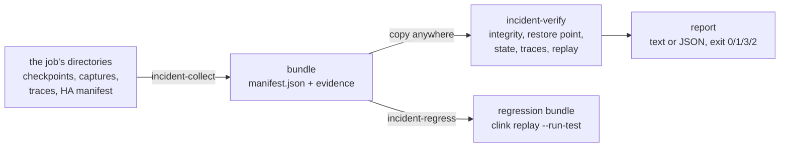

# Incident verification

> How `clink incident-collect`, `clink incident-verify` and `clink incident-regress` turn a job's checkpoints, flight-recorder captures and protocol traces into a portable bundle, check it offline, and freeze a reproduced epoch as a regression test. The design record is [014](../design/014-incident-evidence-bundles.md).

An incident leaves its evidence spread across a job's directories: the checkpoint markers that say which checkpoint a restore chooses, the participants' snapshots and their integrity sidecars, the flight recorder's epochs, the protocol traces of each process, and the coordinator's job manifest. Each of them already has a reader in the engine. A bundle gathers them into one directory with a manifest, so the same readers can run anywhere else, with no cluster and no services, and say what the evidence does and does not establish.



## Commands

```bash
# On the machine that ran the job, while it runs (see "The job manifest" below).
clink incident-collect --checkpoint-dir=/data/ckpt --job=1 --ha-dir=/data/ha \
    --capture-dir=/data/capture --trace-dir=/data/traces \
    --include-state --include-captures --out=incident-1

# Anywhere else.
clink incident-verify incident-1 --profile=replay
clink incident-verify incident-1 --profile=full --op=<window op> --expected=expected.ndjson --json

# Freeze an epoch, then run it as its generated test does.
clink incident-regress incident-1 --op=<op> --epoch=<n> --out=tests/incidents/incident-1
clink replay --run-test=tests/incidents/incident-1
```

`incident-collect` exits 0 when it published a bundle, 1 when it refused (and left nothing at `--out`), 2 on bad usage. `incident-verify` exits 0 when every check the profile requires passed, 1 when any check failed, 3 when none failed but a required check is unavailable or unsupported, and 2 on bad usage or a bundle the reader refuses. A partial result (3) is never reported as success. `incident-regress` exits 0 when the regression bundle is written and passes on this build, 1 when it refuses.

## The bundle

The bundle keeps the engine's own layout under `checkpoint/` and `capture/`, so the functions a restore and a replay use run on it unchanged.

| Path | What | Collected |
| --- | --- | --- |
| `manifest.json` | format, version, collector, the job, the selected checkpoint and the engine's own choice, the delivery report, what the bundle contains, the bounds, the captured epochs, every artifact's path, role, size and SHA-256, what is absent and why, what selection left out | always |
| `job/manifest.json` | the coordinator's job manifest: the graph, the checkpoint settings, whether the sinks need commit confirmation; graph parameters whose names suggest a credential replaced by `<redacted>`, the graph before a rescale left out | `--ha-dir` |
| `checkpoint/_jobs/<job>/` | every `COMPLETED-`, `CONFIRMED-` marker and the `RESTORED` record | always |
| `checkpoint/_state/<job>/v<gen>/<sub>/checkpoint-<id>.snap.meta` | each participant's integrity sidecar for the selected checkpoint | always |
| `checkpoint/_state/<job>/v<gen>/<sub>/checkpoint-<id>.snap` | each participant's snapshot, and each captured epoch's starting snapshot | `--include-state` |
| `capture/op-<id>/subtask-<s>/op.json`, `epoch-<n>.cap` | the flight recorder's epochs and the operator specs | `--include-captures` |
| `traces/<process>.ndjson` | one run of protocol traces | `--trace-dir` |

Snapshots and captures hold the job's records and keyed state. No redaction makes them safe to share, so they are collected only when asked for, and the manifest records whether they were.

The manifest is versioned (`"format": "clink-incident-bundle"`, `"version": 1`). The reader refuses an unknown format, a newer version, a manifest past 16 MiB or nested deeper than 64, more than 100,000 artifacts, an artifact path that is absolute, has an empty, `.` or `..` component, a backslash or a NUL, and a symbolic link anywhere on an artifact's path. It never runs a command or loads a plugin the manifest names.

## Collecting

The collector chooses the checkpoint with the engine's restore rule, through the functions a coordinator takeover calls (`restore_point_on_disk` in `include/clink/cluster/in_doubt_resolution.hpp`): the newest `COMPLETED` marker the `RESTORED` record does not pass over or, when the job's sinks need commit confirmation, the newest `CONFIRMED` one. Which rule applies comes from the job manifest's `requires_commit_confirmation`, or `--commit-confirmation=yes|no`; without either the collector refuses rather than guess, unless `--checkpoint` names the checkpoint. A named checkpoint is recorded beside the engine's choice. For the confirmation family a takeover then runs the in-doubt walk, which asks the sinks' systems and can move the point; offline nothing can say how far, and the restore-rule check says so.

Every state path comes from the one marker, through `resolve_restore_source` and `state_dir_for`, so a bundle never mixes checkpoints or generations. The collector does not pin anything. Instead:

- it lists the job's markers before and after copying and refuses when they differ, which is what a checkpoint completing or a restart being recorded mid-collection looks like;
- it hashes each file while copying and checks the file's size and modification time afterwards, refusing when a file changed or disappeared;
- it builds the bundle in a temporary directory beside `--out` and publishes it with one rename; every refusal removes the temporary directory, and an existing `--out` is never written over.

A refusal says to collect again or stop the job first. Bounds: `--max-bytes` (1 GiB), `--max-files` (10,000) and `--timeout-s` (600). Evidence the selected checkpoint needs refuses the collection when it passes a bound; captures are optional, and those past a bound or outside `--op` and `--epochs` (default: the selected checkpoint's epoch and the next) are listed under `excluded`.

**The job manifest.** A coordinator removes a job's manifest from its HA directory when the job ends, keeping only its terminal status. Collect while the job runs to keep the graph and the restore rule in the bundle; after it has ended, pass `--commit-confirmation`, and the recorded-output check has no graph to read.

**Retention.** A captured epoch replays from the checkpoint before it, and a Worker keeps `--checkpoint-num-retained` completed checkpoints per job (default 2). The default capture window fits that; to be able to replay further back, raise it on the Workers before the incident.

## The checks

Each check reports `passed`, `failed`, `unavailable` (the evidence it needs is not in the bundle, or a tool it needs is not on this machine) or `unsupported` (this release cannot make the check for this evidence), with the evidence it used, the reason, and the next action. `passed` means what the row says and nothing more.

| Check | Passed means | Uses |
| --- | --- | --- |
| `bundle.manifest` | the manifest parses, is a known format and version, and every path in it is a plain relative path | the bundle reader |
| `bundle.artifacts` | every artifact exists as a regular file with its listed size and SHA-256, and nothing unlisted sits in an evidence directory | SHA-256 |
| `bundle.completeness` | the selected checkpoint's marker and every participant's sidecar are listed, and so is everything the manifest claims (snapshots, captures, traces); absences the manifest records are reported, not excused | the manifest |
| `checkpoint.marker` | the selected `COMPLETED` marker parses and names this job, this checkpoint and the manifest's generation | `parse_completed_marker` |
| `checkpoint.restore_rule` | the engine's restore choice, recomputed over the bundle's markers, is the one the manifest recorded | `restore_point_on_disk` |
| `checkpoint.participants` | every participant the marker records has its sidecar under the marker's state root and generation, and, with snapshots, each snapshot verifies against it | `resolve_restore_source`, `state_dir_for`, `verify_checkpoint` |
| `state.decode` | every included snapshot restores through the production restore path; its state names, schema versions and fingerprints are listed | `InMemoryStateBackend::restore` |
| `protocol.trace_structure` | every trace file holds one process, its lines parse, and its sequence numbers run from 1 without a gap | the trace files |
| `protocol.conformance` | the TLC trace validator accepts the run against `formal/ExactlyOnce.tla` | `scripts/formal-check.sh --trace` |
| `replay.determinism` | each selected epoch, replayed twice from its starting state, emits the same rows in the same order | `EpochReplay` |
| `replay.recorded_output` | the replay's rows equal, in order, the rows production handed the operator's single downstream operator in the same epoch | `EpochReplay`, the capture reader |
| `replay.expected_output` | the selected epochs of one operator, each replayed from its starting state, emit an expectation's rows, compared as multisets | `EpochReplay` |

Once `bundle.artifacts` fails, the checks behind it report unavailable rather than read evidence that changed.

`protocol.conformance` needs the repository's `formal/` directory (`--formal-dir` or `CLINK_FORMAL_DIR`), a Java runtime, and the TLA+ jars pinned in `formal/tools.env`, present with their pinned SHA-256 in `${CLINK_DEPS_PREFIX:-~/.clink-deps}/formal-tools` (or `--formal-tools-dir`). It never downloads them: without them it is unavailable, and `scripts/formal-check.sh` is the way to fetch them. It runs the validator over a copy of the traces in the system's temporary directory, which the validator keeps when it rejects a trace so that the TLC log it names can be read. A pass says the run's protocol events are a behaviour of the specification; it says nothing about the records' contents.

### Replay

The replay checks rebuild each captured operator from its `op.json` through the binary's own registry, restore its starting snapshot into an in-memory backend and drive the captured events, as `clink replay` does ([replay determinism](replay-determinism.md)). Three rules come from the incident setting:

- **Where an epoch starts.** Epoch N holds the events between checkpoints N-1 and N, so it starts from checkpoint N-1, except for the first epoch of a restored run. A run restored from checkpoint R numbers its checkpoints from the `next` the `RESTORED` record names, so epoch `next` starts from R (`epoch_starting_checkpoint` in `include/clink/incident/bundle.hpp`). Only the newest restore is recorded; an older restored run's first epoch is replayed from N-1, which a torn checkpoint leaves unavailable rather than wrong.
- **What production emitted.** `replay.recorded_output` reads the downstream operator's own capture of the same epoch, and only where that is the same stream: the operator has exactly one consumer, the consumer has exactly one input, both run at parallelism 1, and neither capture was truncated. The capture is matched to the graph by its uid or, for an operator without one (as SQL's are), by its type and parameters, which the Worker copies from the graph into `op.json`; an ambiguous match is not compared.
- **Which epochs count.** `replay.expected_output` compares the union of the selected epochs of one operator with the expectation, so an expectation need not know where epochs fell. An epoch the `RESTORED` record passes over was processed by a run the restore discarded, and its events were processed again in the restored run's first epoch, so it is left out and listed.

Two replays agreeing establishes determinism and nothing about production. A truncated capture holds a prefix of its epoch: the replay of it can still be deterministic, and the recorded-output comparison is unavailable for it.

Verification replays nothing that leaves the process. Operators that call an external system for each record, lookups and model inference (any operator type naming `lookup` or `predict`), report unsupported without being built, and `incident-regress` refuses them; `clink replay` replays them against the services the job used. Operators that only a job plugin registers report unsupported too: verification loads no plugin. The checks write only to the system's temporary directory.

## Profiles

| Profile | Requires |
| --- | --- |
| `integrity` | `bundle.*` |
| `consistency` (default) | adds `checkpoint.*` and `state.decode` |
| `replay` | adds `replay.determinism` and `replay.recorded_output`, and `replay.expected_output` with `--expected` |
| `full` | adds `protocol.trace_structure` and `protocol.conformance` |

`--op`, `--subtask` and `--epoch` narrow the replays. At most `--max-replays` epochs (default 64) replay per run and the rest are listed; an expectation over a selection the cap cut reports unavailable rather than compare part of it.

## Regression tests

`incident-regress` freezes one captured epoch of a bundle whose artifacts verify into the regression bundle `clink replay --emit-test` writes: the epoch, its starting snapshot, the golden emissions, and a generated gtest whose body is one call to `clink::sql::run_replay_regression`. It runs the bundle once before returning, so a bundle that would not pass is never handed back. `clink replay --run-test=<dir>` runs it as the generated test does, from the command line, and exits 1 with the first divergence when it fails.

## What passing does not mean

The digests establish that nothing in a bundle changed after it was collected. They do not establish who collected it: anyone who can replace the bundle can replace its manifest too, and signing is out of scope. A passing bundle is evidence about the files in it, checked by this build's readers. It is not a proof that the implementation is correct, that the job's business logic is right, or that any external system holds what the job wrote: nothing offline reads a destination.

## Measured

One run of the [example](https://github.com/orhaugh/clink/tree/main/examples/incident-verification)'s gate on an Apple M2 Pro with 32 GB, a job of 24,000 events whose Worker was killed inside its second checkpoint:

| What | Measured |
| --- | --- |
| Collection while the job ran | 0.69 s for two attempts: the first refused because a checkpoint completed mid-copy, the second published |
| The bundle | 6.6 MiB in 54 files: five operators' captured epochs, their starting snapshots, markers, sidecars, three trace files, the job manifest |
| `incident-verify --profile=full` | 1.88 s, including the TLC trace validator over 61 protocol events and the replay of every captured epoch of the window operator |
| The flight recorder on an unpaced 200,000-event file job, medians of three runs | wall 0.89 s off and 1.35 s on (+52%), CPU 0.48 s off and 0.92 s on (+90%), 42.7 MiB of captures |

The recorder's cost is what capturing every operator's input of every epoch costs: it is a diagnostic surface, armed per job with `--capture-dir` and bounded per epoch by `--capture-records`, not something to leave on for every job. A run's `results/summary.txt` and `results/measurements.json` hold its own figures.

## Not supported in this release

Coordination stores other than the local filesystem (an `s3://` checkpoint directory), RocksDB SST checkpoints in `state.decode`, state outside the checkpoint directory, replay of multi-input operators, non-Row channels and plugin operators, a live per-subtask view of a running job, destination reconciliation, and signing.

## Source

| What | Where |
| --- | --- |
| The bundle, its reader, the checks without SQL, collection | `include/clink/incident/bundle.hpp`, `src/incident/bundle.cpp`, `src/incident/collect.cpp` |
| The restore rule both sides share | `restore_point_on_disk`, `read_restore_point` in `include/clink/cluster/in_doubt_resolution.hpp` |
| The replay checks and regression bundles | `include/clink/sql/incident_replay.hpp`, `src/sql/incident_replay.cpp` |
| The commands | `tools/clink_incident.cpp`, with `tools/clink_incident_replay.cpp` or its SQL-off stub |
| Tests | `tests/test_incident_bundle.cpp` (collection, the reader, the core checks), `tests/test_incident_replay.cpp` (replay on a real captured run) |
| The example and gate | `examples/incident-verification/`; `scripts/incident-gate.sh` runs both suites, requires every case to have run, then the example |
