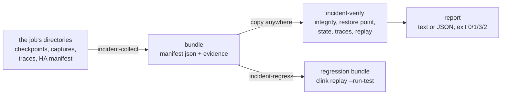
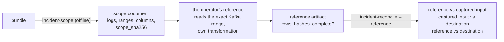

# Incident verification

> How `clink incident-collect`, `clink incident-verify` and `clink incident-regress` turn a job's checkpoints, flight-recorder captures and protocol traces into a portable bundle, check it offline, and freeze a reproduced epoch as a regression test; and how `clink incident-reconcile` reads a ClickHouse destination, explicitly and read-only, to say whether it holds exactly what one completed checkpoint owed it. The design records are [014](../design/014-incident-evidence-bundles.md) and [015](../design/015-destination-reconciliation.md).

An incident leaves its evidence spread across a job's directories: the checkpoint markers that say which checkpoint a restore chooses, the participants' snapshots and their integrity sidecars, the flight recorder's epochs, the protocol traces of each process, and the coordinator's job manifest. Each of them already has a reader in the engine. A bundle gathers them into one directory with a manifest, so the same readers can run anywhere else, with no cluster and no services, and say what the evidence does and does not establish.



## Commands

```bash
# On the machine that ran the job, while it runs (see "The job manifest" below).
clink incident-collect --checkpoint-dir=/data/ckpt --job=1 --ha-dir=/data/ha \
    --capture-dir=/data/capture --trace-dir=/data/traces \
    --include-state --include-captures --out=incident-1

# Anywhere else.
clink incident-verify incident-1 --profile=replay
clink incident-verify incident-1 --profile=full --op=<window op> --expected=expected.ndjson --json

# Freeze an epoch, then run it as its generated test does.
clink incident-regress incident-1 --op=<op> --epoch=<n> --out=tests/incidents/incident-1
clink replay --run-test=tests/incidents/incident-1

# Online, explicitly: does the ClickHouse table hold exactly what checkpoint 12 owed it?
CH_PASSWORD=... clink incident-reconcile incident-1 --checkpoint=12 --key=event_id \
    --host=clickhouse.internal --user=reconciler --password-env=CH_PASSWORD --json

# Audit it against a reference computed outside the job (see "Independent reference audit").
clink incident-scope incident-1 --checkpoint=12 --out=scope.json
python3 my_reference.py --scope=scope.json --bootstrap=kafka.internal:9092 --out=reference.ndjson
CH_PASSWORD=... clink incident-reconcile incident-1 --checkpoint=12 --key=event_id \
    --reference=reference.ndjson --host=clickhouse.internal --user=reconciler \
    --password-env=CH_PASSWORD
```

`incident-collect` exits 0 when it published a bundle, 1 when it refused (and left nothing at `--out`), 2 on bad usage; with `--json`, a refusal is also written to standard output with its kind (`changed`, `missing`, `bound`, `timeout`, `other`). `incident-verify` exits 0 when every check the profile requires passed, 1 when any check failed, 3 when none failed but a required check is unavailable or unsupported, and 2 on bad usage or a bundle the reader refuses. A partial result (3) is never reported as success. `incident-regress` exits 0 when the regression bundle is written and passes on this build, 1 when it refuses. `incident-reconcile` exits as `incident-verify` does, and 2 when the request does not fit the bundle, the destination is not the one its evidence names, or a reference artifact is malformed or bound to another scope. `incident-scope` exits 0 when it wrote the scope document; 3 when the scope's evidence or source positions are not whole (it writes the document once the sink's columns are known), or when the job keeps state across records in a form the audit does not support (it writes nothing); and 2 on bad usage or a request the bundle does not fit.

## The bundle

The bundle keeps the engine's own layout under `checkpoint/` and `capture/`, so the functions a restore and a replay use run on it unchanged.

| Path | What | Collected |
| --- | --- | --- |
| `manifest.json` | format, version, collector, the job, the selected checkpoint and the engine's own choice, the delivery report, what the bundle contains, the bounds, the captured epochs, every artifact's path, role, size and SHA-256, what is absent and why, what selection left out | always |
| `job/manifest.json` | the coordinator's job manifest: the graph, the checkpoint settings, whether the sinks need commit confirmation; graph parameters whose names suggest a credential replaced by `<redacted>`, the graph before a rescale left out | `--ha-dir` |
| `checkpoint/_jobs/<job>/` | every `COMPLETED-`, `CONFIRMED-` marker and the `RESTORED` record | always |
| `checkpoint/_state/<job>/v<gen>/<sub>/checkpoint-<id>.snap.meta` | each participant's integrity sidecar for the selected checkpoint | always |
| `checkpoint/_state/<job>/v<gen>/<sub>/checkpoint-<id>.snap` | each participant's snapshot, and each captured epoch's starting snapshot | `--include-state` |
| `capture/op-<id>/subtask-<s>/op.json`, `epoch-<n>.cap` | the flight recorder's epochs and the operator specs; for a sink, its recorded input, and its `op.json` with credential-like parameters redacted | `--include-captures` |
| `capture/op-<sink>/subtask-<s>/epoch-<n>.sink.json` | a sink's interval evidence: what its interval's capture came to, the barrier before it, and the sink's own account (for the ClickHouse native sink, the destination's identity and the ledger of acknowledged INSERTs) | `--include-captures` |
| `checkpoint/_state/<job>/v<gen>/<sub>/checkpoint-<id>.snap` (role `interval_state`) | each participant's snapshot of the completed checkpoints that bound a collected sink interval, and of the run's restore point, which hold the source positions at both ends | `--include-state` with `--include-captures` |
| `traces/<process>.ndjson` | one run of protocol traces | `--trace-dir` |

Snapshots and captures hold the job's records and keyed state. No redaction makes them safe to share, so they are collected only when asked for, and the manifest records whether they were.

The manifest is versioned (`"format": "clink-incident-bundle"`, `"version": 1`). The reader refuses an unknown format, a newer version, a manifest past 16 MiB or nested deeper than 64, and more than 100,000 artifacts. It checks the type of every field a check reads, so a malformed field refuses the bundle (exit 2) rather than reaching a check. An artifact must sit in one of the evidence directories (`checkpoint/`, `capture/`, `traces/`, `job/`) on a path that is relative, with no empty, `.` or `..` component, backslash or NUL, and no symbolic link anywhere on it. A captured epoch must be listed at the path the replay engine reads for its operator, subtask and epoch, so the file the manifest vouches for is the file replayed; operator ids are written as decimal text, since they use all 64 bits and JSON integers stop at 2^63. The reader never runs a command or loads a plugin the manifest names.

## Collecting

The collector chooses the checkpoint with the function a coordinator takeover chooses with (`restore_point_on_disk` in `include/clink/cluster/in_doubt_resolution.hpp`): the newest `COMPLETED` marker the `RESTORED` record does not pass over or, when the job's sinks need commit confirmation, the newest `CONFIRMED` one. That is the takeover's rule; a resubmitted job resuming its own checkpoints (`clink run` over a checkpoint directory it ran in before) adds the run-base and clean-finish records, which a bundle does not evaluate. Which rule applies comes from the job manifest's `requires_commit_confirmation`, or `--commit-confirmation=yes|no`; without either the collector refuses rather than guess, unless `--checkpoint` names the checkpoint. A named checkpoint is recorded beside the engine's choice. For the confirmation family a takeover then runs the in-doubt walk, which asks the sinks' systems and can move the point; offline nothing can say how far, and the restore-rule check says so.

Every state path comes from the one marker, through `resolve_restore_source` and `state_dir_for`, so a bundle never mixes checkpoints or generations. A marker is its prefix and a checkpoint id and nothing else, as the engine's scans read them, so a writer's temporary file is not collected as one. State in a store a URI names is outside the checkpoint directory and recorded as absent. The collector does not pin anything. Instead:

- it lists the job's markers before and after copying and refuses when they differ, which is what a checkpoint completing or a restart being recorded mid-collection looks like;
- it hashes each file while copying and checks the file's size and modification time afterwards, refusing when a file changed or disappeared;
- it builds the bundle in a temporary directory beside `--out` and publishes it with one rename; every refusal removes the temporary directory, and an existing `--out` is never written over.

A refusal says to collect again or stop the job first. Bounds: `--max-bytes` (1 GiB), `--max-files` (10,000) and `--timeout-s` (600). Evidence the selected checkpoint needs refuses the collection when it passes a bound; captures are optional, and those past a bound or outside `--op` and `--epochs` are listed under `excluded`. By default the epochs are the selected checkpoint's and the next and, when the job's newest restore was from the selected checkpoint, that restored run's first epoch, which numbers from the `RESTORED` record's `next`.

**The job manifest.** A coordinator removes a job's manifest from its HA directory when the job ends, keeping only its terminal status. Collect while the job runs to keep the graph and the restore rule in the bundle; after it has ended, pass `--commit-confirmation`, and the recorded-output check has no graph to read.

**Retention.** A captured epoch replays from the checkpoint before it, and a Worker keeps `--checkpoint-num-retained` completed checkpoints per job (default 2). The default capture window fits that; to be able to replay further back, raise it on the Workers before the incident.

## The checks

Each check reports `passed`, `failed`, `unavailable` (the evidence it needs is not in the bundle, or a tool it needs is not on this machine) or `unsupported` (this release cannot make the check for this evidence), with the evidence it used, the reason, and the next action. `passed` means what the row says and nothing more.

| Check | Passed means | Uses |
| --- | --- | --- |
| `bundle.manifest` | the manifest parses, is a known format and version, and every path in it is a plain relative path | the bundle reader |
| `bundle.artifacts` | every artifact exists as a regular file with its listed size and SHA-256, and nothing unlisted sits in an evidence directory (a directory that cannot be listed in full fails it; the root's other files, such as a report, and the `.DS_Store` and `._*` files macOS leaves are not evidence) | SHA-256 |
| `bundle.completeness` | the selected checkpoint's marker and every participant's sidecar are listed, and so is everything the manifest claims (snapshots, captures, traces); absences the manifest records are reported, not excused | the manifest |
| `checkpoint.marker` | the selected `COMPLETED` marker parses and names this job, this checkpoint and the manifest's generation | `parse_completed_marker` |
| `checkpoint.restore_rule` | the engine's restore choice, recomputed over the bundle's markers, is the one the manifest recorded | `restore_point_on_disk` |
| `checkpoint.participants` | every participant the marker records has its sidecar under the marker's state root and generation, and, with snapshots, each snapshot verifies against it | `resolve_restore_source`, `state_dir_for`, `verify_checkpoint` |
| `state.decode` | every included snapshot restores through the production restore path; its state names, schema versions and fingerprints are listed | `InMemoryStateBackend::restore` |
| `protocol.trace_structure` | every trace file holds one process, its lines parse, and its sequence numbers run from 1 without a gap | the trace files |
| `protocol.conformance` | the TLC trace validator accepts this job's events against `formal/ExactlyOnce.tla`; a run the specification does not model (a rescale, sinks of both families, a first checkpoint above 1) is unsupported, since the validator then checks nothing | `scripts/protocol-trace-merge.py --job`, `scripts/formal-check.sh --trace` |
| `replay.determinism` | every selected epoch was replayed whole, twice from its starting state, and emitted the same rows in the same order both times | `EpochReplay` |
| `replay.recorded_output` | for every selected epoch, the replay's rows equal the rows production handed the operator's single downstream operator in the same epoch, each key's in the same order | `EpochReplay`, the capture reader |
| `replay.expected_output` | every selected epoch of one operator was replayed whole from its starting state, and together they emit an expectation's rows, compared as multisets | `EpochReplay` |

Once `bundle.artifacts` fails, the checks behind it report unavailable rather than read evidence that changed. A check that meets something it did not foresee reports failed with the reason; it does not end the run.

`protocol.conformance` needs the repository's `formal/` directory (`--formal-dir` or `CLINK_FORMAL_DIR`), a Java runtime, and the TLA+ jars pinned in `formal/tools.env`, present with their pinned SHA-256 in `${CLINK_DEPS_PREFIX:-~/.clink-deps}/formal-tools` (or `--formal-tools-dir`). It never downloads them: without them it is unavailable, and `scripts/formal-check.sh` is the way to fetch them. It merges this job's events from a copy of the traces in a fresh temporary directory, as the validator merges a run, so another job's events in the same traces neither pass nor fail the bundle; the validator keeps its own working directory when it rejects a trace, so that the TLC log it names can be read. A pass says the run's protocol events are a behaviour of the specification; it says nothing about the records' contents.

### Replay

The replay checks rebuild each captured operator from its `op.json` through the binary's own registry, restore its starting snapshot into an in-memory backend and drive the captured events, as `clink replay` does ([replay determinism](replay-determinism.md)). Three rules come from the incident setting:

- **Where an epoch starts.** Epoch N holds the events between checkpoints N-1 and N, so it starts from checkpoint N-1, except for the first epoch of a restored run: a run restored from checkpoint R numbers from `next`, so epoch `next` starts from R. The bundle records restores in the job's `RESTORED` record, which names the newest, and in the `Redeploy` events of its traces, which name each one in the traced period (`recorded_restores` and `epoch_start` in `include/clink/incident/bundle.hpp`). A restore it does not record can still have started a run at an epoch before the newest restore. A job outside the confirmation family restores from the newest checkpoint it completed, so such a run started from N-1 whichever it was, or N-1 is torn and the replay is unavailable. A job in the family restores from a confirmed checkpoint, so before the newest restore epoch N is replayed from N-1 only when N-1 was confirmed, and is unavailable otherwise. The first epoch after a rescale is unsupported: its restore re-divided several subtasks' state, and replay restores one subtask's snapshot. The starting snapshot must be one the bundle lists: a marker's state root can name the live directory the bundle came from, which verification never reads.
- **What production emitted.** `replay.recorded_output` reads the downstream operator's own capture of the same epoch, and only where that is the same stream: the operator has exactly one consumer, the consumer has exactly one input, both run at parallelism 1, and neither capture was truncated. The capture is matched to the graph by its uid or, for an operator without one (as SQL's are), by its type and parameters, which the Worker copies from the graph into `op.json`; an ambiguous match is not compared.
- **Which epochs count.** `replay.expected_output` compares the union of the selected epochs of one operator with the expectation, so an expectation need not know where epochs fell. An epoch the `RESTORED` record passes over was processed by a run the restore discarded, and its events were processed again in the restored run's first epoch, so it is left out and listed.

- **Order.** Production's state is built by its own history and the replay's is restored from a snapshot, so an operator that fires many keys at one watermark can visit them in another order. The engine orders each key's rows and nothing across keys, so `replay.recorded_output` compares rows of each key in order, grouping them by the columns the operator declares (`group_key_outputs`, `partition_columns`, `partition_keys` or `partition_by`); an operator that declares none is compared row for row.
- **Per epoch.** An operator whose consumer is a sink (which the flight recorder does not capture), or that does not feed one single-input operator at parallelism 1, cannot be compared by its topology, and an operator this build does not replay cannot be replayed or compared: that epoch is unsupported. Missing or partial evidence makes it unavailable. How these per-epoch results decide a check is the selection rule below.

Two replays agreeing establishes determinism and nothing about production. A truncated capture holds a prefix of its epoch: the prefix is replayed twice and the details say whether it agreed with itself, but the records past the cap were never replayed, so the epoch is unavailable to all three checks. A capture whose header does not say it was truncated but holds fewer records than the header counts was cut short and is unavailable too; the flight recorder writes each epoch file beside its name and renames it into place, so it no longer leaves one, but a bundle can hold files an earlier build wrote.

Verification replays nothing that leaves the process. Operators that call an external system for each record, lookups and model inference (any operator type naming `lookup` or `predict`), report unsupported without being built, judged by the operator the replay engine loaded rather than by the manifest, and `incident-regress` refuses them; `clink replay` replays them against the services the job used. Operators that only a job plugin registers report unsupported too: verification loads no plugin. The checks write only to the system's temporary directory.

## Profiles

| Profile | Requires |
| --- | --- |
| `integrity` | `bundle.*` |
| `consistency` (default) | adds `checkpoint.*` and `state.decode` |
| `replay` | adds `replay.determinism` and `replay.recorded_output`, and `replay.expected_output` with `--expected` |
| `full` | adds `protocol.trace_structure` and `protocol.conformance` |

### Selection and partial results

`--op`, `--subtask` and `--epoch` select the captured epochs the replay checks answer for: every captured epoch that matches them, or every captured epoch in the bundle when none is given. The selection is the scope of each replay check, and nothing else changes it. `--max-replays` (default 64) bounds how many of its epochs one run replays, in the bundle's order (operator id, then subtask, then epoch). The epochs past the bound are not checked: they are counted as omitted, and the first five are named in the details. They are never dropped from the selection.

Each replay check reports its selection's counts: `selected`, `checked`, `passed`, `failed`, `unavailable`, `unsupported` and `omitted` (selected minus checked), as a `counts:` line in the text report and a `counts` object in the JSON report. The check then concludes, in this order:

1. `failed` when any selected epoch failed, whatever the others show, so a divergence is never hidden behind missing or unsupported evidence elsewhere.
2. `passed` only when every selected epoch was checked whole and passed. An empty selection never passes.
3. `unavailable` when any epoch was omitted by the bound or lacked evidence (a missing starting state, a missing downstream capture, a truncated or cut-short capture).
4. `unsupported` when the only gap is epochs this build cannot replay or compare. Supported epochs passing beside them do not establish the selection.

`replay.expected_output` compares rows rather than epochs, so it applies the same rule with one refinement. A row the replay emitted that the expectation does not hold fails the check at once, however much of the selection was replayed. An expected row the replay did not emit fails it only when every selected epoch was replayed whole; otherwise that row may belong to an epoch not replayed, and the result is unavailable.

A required replay check that is unavailable or unsupported makes the run partial (exit 3), and a failed one fails it (exit 1). To complete a partial run, raise `--max-replays` to at least the selection's size, or narrow the selection with `--op`, `--subtask` and `--epoch` to the epochs that need checking: an epoch selected on its own and checked in full can pass.

## Verifying with the network denied

Verification opens no connection by design: it reads the bundle, the `formal/` directory and the pinned TLA+ jars, and writes only to the system's temporary directory. The example and its gate do not take that on trust. Every command the example runs on the bundle once it has moved (`incident-verify`, `incident-regress` and `replay --run-test`) runs under the operating system's network isolation, proven on that machine first by `scripts/network-isolation.sh`:

- **The mechanism.** `sandbox-exec` with a profile that denies all network operations on macOS, and `unshare -rn` (a new user and network namespace, whose loopback is down) on Linux. Another platform has none.
- **The proof.** The wrapper must first run a command, since a wrapper that runs nothing would block every probe too. A local control endpoint, an HTTP server on 127.0.0.1 with a port the system picks, must then answer a request made without isolation, and must not answer the same request made under it.
- **The result.** `enforced` when both hold; `unavailable` when the mechanism is missing or cannot run (a Linux host that does not allow unprivileged user namespaces, for instance); `not-enforced` when the endpoint still answered under isolation; `inconclusive` when it did not answer even without isolation, which tells an isolation failure apart from an endpoint that was never reachable.

Only `enforced` lets a verification run. Anything else stops the example before the job starts, naming the state and why. `ALLOW_UNISOLATED=1` is a development mode for a machine without isolation: the example then runs every step with its verifications unisolated, says so at the start and the end, and exits 3, so a run that used it is never a qualification. The library's test-only variables, which choose the mechanism, the platform or the control endpoint, make an example run not a qualification either, since a control endpoint that answers once would pass any wrapper for isolation. `scripts/incident-gate.sh` takes no such override: it refuses `ALLOW_UNISOLATED` and the test-only variables (exit 2), proves isolation before it runs the suites, fails when isolation is not enforced, and fails on any exit from the example but 0. The example also exits 3, and the gate fails, when `protocol.conformance` was unavailable, since the steps that show a forbidden trace failing and an unmodelled run reported unsupported did not run. `scripts/tests/test_network_isolation.py` takes every path on either platform by injecting the mechanism, the platform and the control endpoint, and exercises the platform's own isolation where it can run.

## Regression tests

`incident-regress` freezes one captured epoch of a bundle whose artifacts verify into the regression bundle `clink replay --emit-test` writes: the epoch, its starting snapshot, the golden emissions, and a generated gtest whose body is one call to `clink::sql::run_replay_regression`. It runs the bundle once before returning, so a bundle that would not pass is never handed back. `clink replay --run-test=<dir>` runs it as the generated test does, from the command line, and exits 1 with the first divergence when it fails.

## Destination reconciliation

`clink incident-reconcile` answers what offline verification cannot: whether a destination holds exactly the effects one completed checkpoint owed it. It is a separate command, run when asked, against a connection the operator names. Offline verification stays network-free. [Record 015](../design/015-destination-reconciliation.md) sets out the contract and why.

**Supported.** In this release:

- **Source**: a Kafka SQL source.
- **Transformation**: record-wise (filters and projections).
- **Sink**: the ClickHouse native sink, at least once.
- **Table**: a plain non-replicated `MergeTree` with no `TTL`.
- **Key**: integer or `String` columns (`--key`) that identify one row the job writes.

Anything else is refused or reported unsupported, by name.

**The evidence.** The flight recorder now records each sink as it records an operator. Workers armed with `--capture-dir` do two things for the user's sinks (not the engine's network bridges):

- record the sink's input per checkpoint interval;
- after the sink's `on_barrier` returns and before the barrier is acknowledged, write `epoch-<N>.sink.json` atomically (`include/clink/runtime/sink_evidence.hpp`).

The ClickHouse native sink adds its own account through the Internal `IntervalEvidenceSink` interface:

- the destination as its open found it: the server's and the table's UUIDs, the engine and its definition, the deduplication and async-insert settings, and the column plan;
- the INSERTs the interval's barrier waited for: each one's token, rows, attempts, and whether a resend in doubt was one the table deduplicates or one that may land twice.

`incident-collect --include-captures` takes these files. With `--include-state` it also takes the snapshots of the checkpoints that bound each interval, where the Kafka positions are. A sink's captures are left out of the replay checks, which see a bundle as before.

**The scope** of completed checkpoint N is every interval it completed: back through each interval's previous barrier to the previous completed checkpoint, or to the start of the run. When the run began at a restore, it starts at the restore point. Every sink subtask's evidence for each interval must be there, whole and untruncated. The expected rows are the sink's recorded input over those intervals. For a record-wise job, they are the transformation of the source records between the bounding checkpoints' positions, which the report gives per partition. Kafka positions are the next offset to read, so a scope consumed `[from, to)`. Beside its positions the source records the log they belong to, the topic, the cluster's id and the topic's id (see the [Kafka connector](../connectors/kafka.md#delivery-semantics)), and the report gives it for both ends of the scope. When the ends name different logs, a topic deleted and created again between them, the report says so: the offsets are then not a range of one log. The verdict does not change, since it compares the destination with the sink's own record of its input.

**The read.**

- **The connection is the operator's.** It is given on the command line, with the password from the environment variable `--password-env` names. Nothing is taken from the bundle but names, quoted as identifiers, and key values, rendered as typed literals.
- **Read only.** Every statement is a `SELECT` carrying `readonly = 2`, under which the server refuses any write in it.
- **Bounded.** Every statement runs under `max_execution_time` and `max_result_rows`, both set to throw. `--query-timeout-ms`, `--max-rows-per-query` and `--keys-per-query` set them. A read past a bound leaves the comparison unavailable rather than decided on part of an answer.
- **Identity.** The server's and the table's UUIDs must be the evidence's, or the run is refused.
- **Two reads.** The rows of the scope's keys are read twice, `--settle-ms` apart. The table's mutations are read before and after.

The reader's user needs `SELECT` on the table and on `system.tables`, `system.columns` and `system.mutations`.

**The comparison** is of whole rows as multisets, key by key. Counts, totals and digests decide nothing.

| Type | Compared as |
| --- | --- |
| integers, `Bool` | exact |
| floats | IEEE-754 bits; every NaN equal, -0.0 and +0.0 different |
| decimals | the unscaled integer at the column's scale |
| `DateTime64` | ticks at the column's precision, from the row's epoch milliseconds |
| dates | days |
| strings | bytes |
| NULL | equal only to NULL |

Each key's rows are missing, changed, duplicated or unexpected, and any of these fails the result. The report separates them:

- Missing, changed and unexpected rows break the at-least-once guarantee.
- Duplicates do not, but the table then does not hold the scope exactly once. When the evidence explains them, by a resend that may land twice or a restore at the scope's start, the report says so.

**The checks and verdicts.**

| Check | Passed means |
| --- | --- |
| `bundle.manifest`, `bundle.artifacts`, `bundle.completeness` | as for `incident-verify`; when they fail, nothing else is read |
| `reconcile.scope` | the sink's input for the scope is in the bundle whole, and the key identifies one row of it |
| `reconcile.destination` | the destination is the one the evidence names, a plain `MergeTree` without TTL, with every column the sink wrote as it was |
| `reconcile.rows` | the table holds exactly the scope's rows, each once and value for value, and two reads agreed |

The result is:

- **Exit 0**: every check passed.
- **Exit 1**: a check failed.
- **Exit 3**: none failed, but one is unavailable or unsupported. Examples are evidence missing, truncated or disarmed; a sink ledger that does not account for exactly the rows its recorded input holds; a scope whose intervals held no rows, which establishes nothing; a bound or timeout hit; a mutation in progress or begun during the read; a key read differently twice; or an unsupported table, column type or key.
- **Exit 2**: refused. That is another job (`--job`), a checkpoint the bundle does not hold as completed, or another database, table, server or table UUID than the evidence's.

`--json` and `--report` write the versioned report (`"format": "clink-reconcile-report"`, `"version": 1`). It holds the observation's times on both clocks, the scope with its source ranges, the log they belong to and each interval's INSERT ledger, the destination as recorded and as observed, the method, the assumptions, mutations done before the read, each check, and the first discrepancies (`--list`). `--expected-out` writes the expected rows as canonical cells, one JSON object per line, for an independent check of the expectation. [`examples/destination-reconciliation/`](https://github.com/orhaugh/clink/tree/main/examples/destination-reconciliation) does that check: it confirms the topic is still the log the source recorded, reads each scope's source range back from it, and runs every scenario the contract covers.

**Three kinds of assurance.** None implies the next:

- The delivery report in the bundle says what the job's configuration supports.
- `incident-verify` says that the recorded execution is intact and passes the protocol and replay checks.
- `incident-reconcile` says that the destination, observed once, holds exactly what one checkpoint owed it.

## Independent reference audit

Reconciliation compares the destination with the sink's own record of its input. That establishes whether the writes arrived. A transformation that computes the wrong rows writes them faithfully, so its captured input and its destination agree and reconciliation passes. Only an expectation computed outside the job, from the same source records, can tell. The audit takes one from the operator and compares three relationships separately, so that one passing cannot hide another failing.



**The scope document.** `clink incident-scope` reads the bundle alone, with its integrity checked, and writes the scope a reference computes from (format `clink-audit-scope`, version 1). It holds:

- the job, the sink and its runner attempts, and the SHA-256 of the job graph the bundle recorded;
- the bounding checkpoints, and whether the scope spans the run from its start (`--from-run-start`);
- each Kafka source's topic, cluster id and topic id, isolation level, and per partition the range `[from, to)`;
- the sink's columns, and the comparison's semantics (`clink-canonical-cells-v1`);
- `scope_sha256`, over the rest.

**The reference artifact** (format `clink-reference-result`, version 1) is NDJSON:

1. a header holding the scope document verbatim and the implementation's name, version and configuration;
2. one line per expected row, as canonical cells, with copies kept;
3. an end line holding the row count, the SHA-256 of the row lines and of the header line, whether the reference is complete, and if not why, and what its writer verified and recorded.

The audit refuses (exit 2) an artifact that is malformed, has no end line, does not hash to its end line, holds a cell that is not canonical for its column, or names another scope. The refusal names the first field that differs, such as another checkpoint, range, topic id or column. An artifact that says it is incomplete is bound and never compared, so the audit is partial.

Nothing an artifact names is run, loaded or connected to. Its hashes show the file is whole as its writer finished it, not who wrote it, and not that its implementation is independent of the job. The report keeps what the audit verified apart from what the artifact only records:

- **Verified:** the binding to the scope, the hashes, and the cells' form.
- **Recorded:** the implementation, its configuration, the client library, and any offsets the operator supplied.
- **The writer's own checks:** listed as such.

**A reference implementation.** [`python/clink-reference`](https://github.com/orhaugh/clink/tree/main/python/clink-reference) reads a scope's exact Kafka ranges on a connection and credentials the operator gives, and writes the artifact. The transformation is the operator's, written from the job's specification and never from clink's evaluator or sink conversions. Before reading, the library confirms the cluster's id and the topic's id are the ones the job recorded, and that the topic does not compact. Under `read_committed`, a range's transaction markers and aborted records hold offsets that are never delivered. So the library does not take a range's span as its record count, and does not take a quiet poll as its end. A range is complete only once a record at or past its end was delivered, or the end of the log was reached at or past it. Each of these leaves the reference incomplete, with the reason, rather than complete over what remains:

- expired or compacted history;
- a recreated topic, or another cluster;
- a log that ends early;
- an error, a deadline or a bound reached first.

**The audit.** `clink incident-reconcile --reference=<artifact>` adds these checks to the reconciliation's:

| Check | Compares | A failure means |
| --- | --- | --- |
| `reference.scope` | the artifact against the audit's own scope document | (unavailable when the reference is incomplete) |
| `reference.capture` | the reference's rows against the sink's captured input | the transformation: the job computed other rows than the reference, before any write |
| `reconcile.rows` | the captured input against the destination, over its own keys, as without a reference | the delivery: the destination does not hold what the sink received |
| `reference.destination` | the reference against the destination, over the union of the reference's and the captured input's keys | the destination does not hold what the reference computes |
| `destination.coverage` | with `--coverage=complete-table`: the whole table against the expected rows | the table holds rows the scope does not account for, or lacks some |

Every comparison is of whole typed rows with their copies counted, under the canonical cells above. NULLs, decimals, timestamps, strings and floats are compared as reconciliation compares them. The destination is read for the union of keys, so a row the job dropped is looked for under the reference's key, and a row it introduced is read under its own. The report lists findings by relationship (`transformation`, `delivery`, `reference-destination`, `coverage`), so that a wrong transformation written faithfully reads as one, and is not mistaken for a delivery fault. The verdicts are reconciliation's:

- **Exit 0:** every required check completed and passed.
- **Exit 1:** any check failed. An observed discrepancy wins over evidence that is unavailable.
- **Exit 3:** none failed, but one required check is unavailable or unsupported.
- **Exit 2:** refused.

**Coverage.** A destination read selects keys, and rows of other keys are not read. A passing result therefore says "for the selected keys", and the report's `coverage` names how many keys were selected and that the rest of the table is not established. `--coverage=complete-table` also reads the table whole, at most `--max-table-rows` rows, and requires it to hold exactly the expected rows: the reference's when there is one, the captured input's otherwise. That catches a row of a key neither side names. Its scope spans the run from its start (as `--from-run-start`). The check is established only when all of these hold, and is otherwise unavailable:

- the operator declares the table holds this one bounded run's writes and nothing else (recorded as an assumption);
- the run began with no state, so no earlier run's rows can be in the table;
- the bundle shows the run had stopped writing: every sink subtask's interval for at least two barriers after the checkpoint, all empty, and none after it with rows;
- the table's active parts are the same before and after the read (`system.parts`, so the reconciling user needs `SELECT` on it);
- no mutation is in progress.

Two equal reads alone do not establish that a table was still. A shared or continuously written table keeps the selected-key comparison, and its completeness stays unavailable. An empty expected output does not pass by having nothing to compare: with selected keys no key is selected and the result is partial, and read whole it passes only when the table is empty.

## Auditing windowed results

A record-wise job's rows in a checkpoint's scope come from the records in that scope. A window's row does not. It holds records from any earlier interval, and it exists only once the watermark has passed its end. A record arriving after that is dropped, and whether one did depends on the order the job read its partitions in, which offsets do not record. The audit supports one windowed shape, for which it decides each of those questions from the source and the recorded evidence, and leaves out, by name, any it cannot decide.

```bash
# The scope of a windowed job is its lineage: from a start with no state to checkpoint 41.
clink incident-scope incident-7 --checkpoint=41 --out=scope.json
python3 reference_windows.py --scope=scope.json --bootstrap=kafka.internal:9092 \
    --run-start-offset=ALL=0 --out=reference.ndjson
# The key is the windows' identity, which the bundle names.
CH_PASSWORD=... clink incident-reconcile incident-7 --checkpoint=41 --reference=reference.ndjson \
    --coverage=complete-table --host=clickhouse.internal --user=reconciler --password-env=CH_PASSWORD
```

**The supported job.**

| Part | Supported |
| --- | --- |
| Source | One Kafka SQL table. A source subtask may own several partitions, or none, when its Worker records the partitions its watermark waited for (see below). |
| Event time | An integer column of epoch milliseconds, the source table's `event_time_column`. |
| Watermark | `watermark_lag_ms`, and no `idle_timeout_ms`. Each partition's greatest event time so far, the least of those over the partitions, less the lag. It is assigned to every record the source delivers, before any filter. |
| Transformation | Record-wise filters and projections, the time column passed through unchanged. |
| Window | One keyed `TUMBLE`, with `COUNT` and `SUM` (not `DISTINCT`). A record at time t is in `[s, s + size)`, where `s = floor(t / size) * size`. |
| Closing and lateness | A window closes once the watermark reaches its end plus `allowed_lateness_ms` (default 0); reaching it exactly closes it. A record for a window that has closed is dropped. `late_records_to_dlq` does not change the output. |
| Output | The window's rows as the window computes them, into the ClickHouse native sink. A row's identity is its group key columns, `window_start` and `window_end`, which is the audit's key. |
| Checkpoints | Aligned, as the job manifest records them (`alignment`, which the Coordinator persists). |

Anything else is refused by name: `incident-scope` exits 3 without writing a scope, and an audit's reference checks are unsupported, while the delivery is still checked. That covers sliding, session and cumulating windows, joins, other aggregates, a filter after the window, idleness (which drops a quiet partition from the watermark after wall-clock time the records do not show), unaligned checkpoints, and several partitions to a source subtask on a Worker that does not record the partitions its watermark waited for. An older Worker's watermark took the least over only the partitions it had read from, so its first fetches decided which records were late.

**What decides a record's fate.** The window operator's watermark when a record arrives is bounded from above by the source alone, and from below by evidence:

- *Its own partition.* A source subtask's watermark is the least over the partitions it owns, each holding until it delivers ([time and windowing](./time-and-windowing.md#guarantees-and-caveats)), so the watermark is at most the record's partition's greatest earlier event time, less the lag. The audit takes that hold from the assigners' record of the partitions their source declared (`__clink_wm_declared`). A Worker that holds writes it at every barrier, empty until its source declares any. Every lineage checkpoint must hold it for each source subtask that owns partitions, naming every one the subtask owned once it names any. A subtask that owns none marks its output idle, and contributes nothing to either bound.
- *The next barrier.* With aligned checkpoints, nothing past a barrier reaches the window operator before the barrier does. So when a record arrives, the watermark is at most the least, over partitions, of the greatest event time before the next checkpoint's positions, less the lag. The reference computes that bound at every checkpoint of the lineage (`source_bounds`).
- *The previous barrier.* The window operator forwards a watermark after closing what it closes, and the sink records the last watermark it had at each barrier. The least over the sink's subtasks, at the checkpoint before the record, is a floor on the watermark when the record arrived.

A record whose window closes above the upper bound was folded in. One whose window closes at or below the floor was dropped. Anything between is undetermined, and so is its window, which the reference lists as left out rather than guessing. A window is final at the audited checkpoint when its end plus the lateness is at or below the watermark the sink recorded there. It is open when above what the source allows there, and undetermined between the two. In the example's runs the recorded watermark equals the source's bound at every checkpoint, so the band is empty.

**Recomputed and recorded.** The window's rules come from the job graph. The reference declares its own, its operator's specification, in the artifact's `semantics`, and does not read the job's. The recorded watermarks are the sink's interval evidence. The bounds are the reference's computation from the source. The audit holds each against the others:

| Check | Passed means |
| --- | --- |
| `reference.semantics` | The job's window rules are the reference's: kind, size, time column, watermark strategy, lag and idleness, allowed lateness and late records. |
| `reference.watermark` | At every completed checkpoint of the lineage, the watermark the sink recorded is no further on than the source's records allow. Every window row the sink received had closed by the bound at the checkpoint after it. A job whose watermark ran ahead, or that closed a window early, fails it. |
| `reference.finality` | Every window the reference computed is decided. Every row it gives is of a window the recorded watermark had closed. Every window it leaves out as open is one the recorded watermark had not closed, so a reference cannot hide a window from the comparison by calling it open. An undetermined window makes it unavailable. |

`reference.capture`, `reconcile.rows`, `reference.destination` and `destination.coverage` then compare as they do for a record-wise job, keyed by the windows' identity, with the windows the reference leaves out kept out of every comparison with the reference.

**The scope and the artifact.** A windowed job's scope document is version 2. Its sources start at the job's own start, which its checkpoints do not record, so the reference is given the run's first offsets (`--run-start-offset`) and records them as the operator's. It adds:

- `transform`: the window's rules as the job declares them;
- `lineage`: the restores it passes and, at each completed checkpoint, the source's positions and the recorded watermark;
- `finality`: the checkpoint and the watermark windows are final by.

The lineage runs back through every restore the bundle records, its `RESTORED` record and its traces, into the run that completed the restored checkpoint, until a run that began with no state. A restored checkpoint the bundle does not hold, or an interval of the lineage missing from it, leaves the scope unavailable. The reference artifact for it is version 2 too:

- its header's `semantics`;
- a `window` line per window left out: its identity, whether open or undetermined, and why;
- in its end line, the window lines' count and hash beside the rows', `source_bounds`, and an account of what became of every record: folded, dropped late, undetermined or filtered.

[`python/clink-reference`](https://github.com/orhaugh/clink/tree/main/python/clink-reference) computes it (`TumblingWindows`) from the records it reads, with the window rules the operator declares (`WindowRules`) and the operator's own reading of each record.

**Recovery.** The lineage holds what the surviving runs processed. A run the restore discarded may have written windows to the destination after the restored checkpoint. The restored run then writes them again, under fresh INSERTs, and the destination holds them twice. The comparisons count those copies, `reconcile.rows` and `reference.destination` fail with them, and the report puts them down to the restore. Nothing is collapsed with `DISTINCT` to make a run pass. A discarded run that decided an undetermined record otherwise leaves a changed row, and the report shows that too.

**Coverage.** A selected-key read selects the identities of the reference's final windows and of the captured rows. `--coverage=complete-table` compares the whole table with the final windows, on the same conditions as for a record-wise job. Rows of undetermined windows are counted and left out, and a row of an open window, or of an identity neither side names, fails.

**What a passing windowed audit establishes.** The job's declared window rules are the reference's. Its recorded watermark never ran ahead of what the source's records allowed, and no window closed early. Every window final at the audited checkpoint holds exactly the reference's value, computed outside the job from the job's whole lineage. That holds in the sink's captured input and in the destination for the identities read, or the whole table under `complete-table`, with copies counted. It establishes nothing about windows still open at the checkpoint, nor records after it. Like the record-wise audit, it is only as independent as the reference.

## What passing does not mean

The digests establish that nothing in a bundle changed after it was collected. They do not establish who collected it: anyone who can replace the bundle can replace its manifest too, and signing is out of scope. A passing bundle is evidence about the files in it, checked by this build's readers. It is not a proof that the implementation is correct, that the job's business logic is right, or that any external system holds what the job wrote: nothing offline reads a destination. A passing reconciliation establishes one checkpoint's effects in one table at one observation time, against what the job's own sink received. It does not establish that the transformation is right, which the replay checks and an independent reference address, nor that the rows survive the server's host losing power, nor anything about the table after the read. A passing audit adds that the job's output, and the destination over the keys read, equal what a reference computed outside the job, from the same records. That is only as independent as the reference is, and the audit cannot establish that. With selected keys, it establishes nothing about rows of other keys.

## Measured

Five runs of the [example](https://github.com/orhaugh/clink/tree/main/examples/incident-verification)'s gate on an Apple M2 Pro with 32 GB, sharing the machine with other work. Each run was a job of 24,000 events whose Worker was killed inside its second checkpoint:

| What | Measured |
| --- | --- |
| Collection while the job ran | 0.24 to 0.47 s; 0.69 s in the run whose first attempt was refused because a checkpoint completed mid-copy |
| The bundle | 6.6 to 6.8 MiB in about 54 files: five operators' captured epochs, their starting snapshots, markers, sidecars, three trace files, the job manifest |
| `incident-verify --profile=full` | 0.98 to 1.95 s, including the TLC trace validator over 61 to 71 protocol events and the replay of every captured epoch of the window operator |
| The flight recorder on an unpaced 200,000-event file job, medians of three runs | CPU 0.46 to 0.50 s off and 0.84 to 0.96 s on (+82% to +91%); wall time +2% to +70%, which the machine's other load decided more than the recorder; 42.7 MiB of captures |

The recorder's cost is what capturing every operator's input of every epoch costs: it is a diagnostic surface, armed per job with `--capture-dir` and bounded per epoch by `--capture-records`, not something to leave on for every job. A run's `results/summary.txt` and `results/measurements.json` hold its own figures.

## Not supported in this release

Coordination stores other than the local filesystem (an `s3://` checkpoint directory), RocksDB SST checkpoints in `state.decode`, state outside the checkpoint directory, replay of multi-input operators, non-Row channels and plugin operators, a live per-subtask view of a running job, and signing.

Destination reconciliation does not support:

- destinations other than the ClickHouse native sink into a plain `MergeTree`;
- replicated, distributed or row-rewriting tables, and tables with a TTL;
- column types beyond those above;
- jobs that are neither record-wise nor the windowed shape above: sliding, session and cumulating windows, joins, other aggregates, idleness, unaligned checkpoints, several partitions to a source subtask without the record of its declared partitions;
- sinks of an embedded `clink run`, which the recorder does not record;
- `system.query_log` as acknowledgement evidence.

## Source

| What | Where |
| --- | --- |
| The bundle, its reader, the checks without SQL, collection | `include/clink/incident/bundle.hpp`, `src/incident/bundle.cpp`, `src/incident/collect.cpp` |
| The restore rule both sides share | `restore_point_on_disk`, `read_restore_point` in `include/clink/cluster/in_doubt_resolution.hpp` |
| The replay checks and regression bundles | `include/clink/sql/incident_replay.hpp`, `src/sql/incident_replay.cpp` |
| The commands | `tools/clink_incident.cpp`, with `tools/clink_incident_replay.cpp` or its SQL-off stub, and `tools/clink_incident_reconcile.cpp` or its stub without the ClickHouse connector |
| Sink interval evidence | `include/clink/runtime/sink_evidence.hpp`, `src/runtime/sink_evidence.cpp`, the sink runner in `include/clink/runtime/dag.hpp`; the ClickHouse native sink's account in `impls/clickhouse/src/native/` |
| Destination reconciliation | `include/clink/incident/reconcile.hpp`, `src/incident/reconcile.cpp`; the ClickHouse reader `impls/clickhouse/include/clink/clickhouse/reconcile_destination.hpp`, `impls/clickhouse/src/reconcile_destination.cpp` |
| The independent reference audit | `include/clink/incident/reference.hpp`, `src/incident/reference.cpp` (the scope document, the artifact's reader, the multiset comparison); a windowed job's shape and lineage in `src/incident/window_scope.cpp` and `load_scope`, its checks in `src/incident/reconcile.cpp`; the reference library `python/clink-reference/` (`windows.py` for windows) |
| Tests | `tests/test_incident_bundle.cpp` (collection, the reader, the core checks), `tests/test_incident_replay.cpp` (replay on a real captured run), `tests/test_incident_reconcile.cpp` (the cells, the comparison, the sink's interval evidence, whole reconciliations, `ReconcileWindow.*` for windowed jobs), `impls/clickhouse/tests/test_reconcile_destination_live.cpp` (the reader against a real server, in `scripts/clickhouse-live.sh`), `python/clink-reference/tests/`, and the examples `examples/destination-reconciliation/` and `examples/window-audit/` |
| The example and gate | `examples/incident-verification/`; `scripts/incident-gate.sh` runs both suites, requires every case to have run, then the example |
| Network isolation, proven before verification relies on it | `scripts/network-isolation.sh`, tested by `scripts/tests/test_network_isolation.py` |
