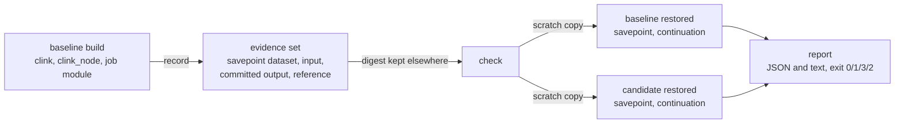

# Upgrade validation

> How `clink-audit upgrade` answers one question before an upgrade: can this candidate build read the state a baseline build retained, restore the supported job from it, and reproduce the checked results? `record` keeps the evidence with the baseline; `check` restores both builds from their own copies of it and reports each part of the answer separately. The runnable example is [`examples/upgrade-check/`](https://github.com/orhaugh/clink/tree/main/examples/upgrade-check).

An upgrade asks several questions that are easy to run together. A candidate that can decode an old snapshot may still refuse to restore it. One that restores it may lose a timer, or put an operator's state under an identity nothing reads. One that runs to the end may produce different rows. And two builds that produce the same rows may both be wrong. The workflow answers each question in its own check, against evidence that neither build can rewrite, and passes only when every required check completes and passes.



## The supported contract

One job, one configuration. The job is [`examples/upgrade-check/upgrade_job.cpp`](https://github.com/orhaugh/clink/blob/main/examples/upgrade-check/upgrade_job.cpp), compiled against each build:

- A controlled source reads numbered segment files from a local directory. Each line is an event (`E,<time>,<account>,<amount>`), a watermark (`W,<time>`) or `END`, so the watermarks are part of the input and every run sees the same ones. Its position (segment, line, last watermark) is its operator state, and a restored source emits its last watermark again first.
- `uc-windows`: the engine's keyed event-time tumbling window, 10 s, accumulating a count and a sum in keyed state (slot `windows`, state version 1).
- `uc-idle`: keyed state `last_seen` and `idle_count`, and an event-time timer per account at `last_seen` plus 30 s, keyed in the keyed state's own encoding.
- Two sinks write lines to local files. Nothing in the job talks to a network service.

The keyed operators run at parallelism 2 on one Coordinator and one Worker from each build. The test definition, [`examples/upgrade-check/test.json`](https://github.com/orhaugh/clink/blob/main/examples/upgrade-check/test.json) (`clink-upgrade-test` version 1), fixes the semantics, the input (a seeded, deterministic workload), the operators' uids and the capabilities a build must report. A definition of another kind or version is unsupported, not guessed at.

A build is three files named explicitly: `clink`, `clink_node` and the job module compiled against that build. A fourth, the tools `clink`, exports, verifies and lists checkpoint datasets; it is named explicitly too and identified in the report. Nothing an evidence set names is ever run.

## Recording evidence

```bash
clink-audit upgrade record --test=examples/upgrade-check/test.json --out=<fresh dir> \
    --tools-clink=build/clink \
    --baseline-clink=<clink> --baseline-node=<clink_node> --baseline-job=<upgrade_check_job.so>
```

The baseline runs the job over the input up to the definition's cut, while windows are open and timers are pending. Once its keyed operators report the cut's last watermark, the gate takes a savepoint (`clink savepoint`) and exports it with the tools build as a [checkpoint dataset](state-snapshot-format.md#checkpoint-datasets) while the job still runs, then cancels the job. The evidence set (`clink-upgrade-evidence` version 1) holds:

| Path | Contents |
| --- | --- |
| `evidence.json` | the test definition's SHA-256, the baseline's identity, the savepoint (job, checkpoint, dataset digest, last watermark, every operator's uid, id and subtasks), the record-time checks, and every other file's SHA-256 and size |
| `test.json` | the test definition, byte for byte |
| `input/` | every segment of the input, the continuation included |
| `checkpoint/` | the savepoint as a checkpoint dataset |
| `output/` | what the baseline's sinks wrote before the savepoint |
| `reference.json` | the independent reference's expected rows and states |

`record` prints the set's digest, the SHA-256 of `evidence.json`. Keep it somewhere the set is not: `check` needs it, and through it every file is bound. Before it publishes, `record` compares the baseline's committed output and the savepoint's decoded state with the reference's expectation at the cut; it publishes either way and exits 1 when they differ, so a baseline that is already wrong is visible before anything is compared with it.

## Checking a candidate

```bash
clink-audit upgrade check --test=examples/upgrade-check/test.json \
    --evidence=<evidence> --evidence-digest=<digest> --out=<fresh dir> --tools-clink=build/clink \
    --baseline-clink=... --baseline-node=... --baseline-job=... \
    --candidate-clink=... --candidate-node=... --candidate-job=...
```

The evidence is verified before anything runs. Each build then gets a scratch copy of the savepoint and runs through the engine's own restore path: `clink run --restore-from-dir=<copy>/_jobs/<job> --restore-from-checkpoint-id=<n>` on its own cluster. Before the restored job reads anything new, the gate takes a savepoint of it and decodes it. The restored job's input directory starts without the recorded segments, so a job started fresh rather than restored holds nothing at that savepoint and cannot pass. Then the continuation is published, the job runs to `END`, and its final checkpoint is exported.

| Check | Required | Passes when |
| --- | --- | --- |
| `evidence.integrity` | yes | `evidence.json` has the recorded digest, every file it lists hashes as recorded, it lists every file present, no link is followed, the dataset has the digest the index records, and the evidence was recorded for the test definition given |
| `isolation` | yes | loopback-only isolation was proven before any build ran (below) |
| `builds.identity` | yes | every file of both builds is hashed, and the baseline is the build that recorded the evidence |
| `builds.capabilities` | yes | both builds report what the definition requires; a capability not reported is `unsupported` |
| `evidence.readable` | yes | the tools build verifies the dataset against its digest and every row decodes in the job's documented encodings |
| `schema.candidate` | yes | the candidate's own `clink check-savepoint --expected=<its job>` accepts every snapshot |
| `restore.baseline`, `restore.candidate` | yes | the build accepted the restore, and its restored savepoint holds the evidence's state logically, every operator that holds state present under the same id and uid |
| `recovery.baseline`, `recovery.candidate` | yes | the continuation ran to `END` with a checkpoint after the restored savepoint |
| `behaviour.output` | yes | the candidate's continuation rows equal the baseline's |
| `behaviour.state` | yes | the candidate's final logical state equals the baseline's |
| `reference.candidate` | yes | the baseline's committed rows plus the candidate's equal the reference's, and its final state equals the reference's |
| `evidence.unchanged` | yes | every file of the evidence hashes after the runs as it did before |
| `reference.baseline` | no | the same for the baseline |
| `state.raw` | no | `clink state-diff` finds the candidate's restored savepoint byte for byte equal to the evidence's |
| `replay.determinism` | no | unsupported: the job is compiled and the evidence carries no captures |

A check is passed, failed, unavailable (it could not run or could not decide: a timeout, a limit, a step it depends on) or unsupported. The result is `failed` (exit 1) when any check that is not informational failed, whatever else could not run; `passed` (exit 0) only when every required check passed; otherwise `not established` (exit 3). Bad usage, such as an existing `--out`, exits 2. When `behaviour.*` fails, its reason says which side the reference agrees with.

## How it compares

Rows are parsed into typed tuples and compared as multisets, so a repeated row and a missing one both count and no two encodings of one value can differ. Neither the job nor the engine documents an order across keys or across windows that fire at the same watermark, so order is not compared.

State is compared logically. The tools build lists a dataset (`clink state-cat --dataset --json`) and the gate decodes each row with the job's documented encodings: the source's position, each open window's count and sum, `last_seen`, `idle_count` and the pending timers. An operator-state row counts only from a subtask that runs its operator; copies held by other subtasks (a release before 04963a61 handed every restored subtask every participant's operator state, and they wrote it on) are counted and reported, never compared as state. A row in no documented encoding is listed, never dropped. Raw bytes are compared separately by `clink state-diff`, labelled raw and informational, because a format may encode one value in more than one way.

The independent reference (`clink_audit/upgrade/reference.py`) computes the expected rows and states from the test definition alone, by the job's specification: an event falls in the window `[s, s + 10 s)`; a window emits when the watermark reaches its end; an idle timer fires at the first watermark at or past it and emits when `last_seen` has not moved. An input with an event behind the watermark breaks the contract and is refused. Agreement between the two builds is never taken as correctness: `behaviour.*` and `reference.candidate` are separate checks, and the example shows two builds that agree and are both wrong.

## Isolation and limits

Every build process reaches loopback and nothing else. On macOS each runs under `sandbox-exec` with the loopback profile of `clink_audit.isolation.LoopbackIsolation`. On Linux a network namespace is per process, so the gate re-executes itself once inside a new user and network namespace (`unshare -rn`, loopback brought up by `netns_exec.py`) and everything it starts shares it. Run where `unshare` is refused, as in a container under Docker's default profiles, the gate can instead run in a container started with `--network none`: a namespace whose only interface is `lo` needs no re-execution, and the gate checks that `lo` is the only interface before the same probes. CI does this, in the `upgrade-gate` job. Before any build runs, the gate proves it: a connection to 192.0.2.1 attempted without the isolation must not be refused, the same connection under it must be refused before a packet leaves, and loopback must work under it. Where the environment itself is the isolation (`--network none`), there is no without: that `lo` is the only interface is checked instead.

A run is bounded by `--run-timeout-s`, the resident memory of its processes (`--max-rss-mib`), the bytes it writes (`--max-output-mib`) and `--timeout-s` for the whole command. A process that exits unexpectedly is a crash and fails its check; a limit reached, or SIGINT or SIGTERM to the gate, stops the run and leaves its checks unavailable, and the report is still written. Every command, its exit status and its log are kept under `--out`.

## What it does not establish

The result is compatibility of this candidate for this job, this evidence and this configuration. It is not a claim that every job, every operator or every checkpoint upgrades, and the input is synthetic. It covers the file state backend on one Worker; other backends, rescales across the upgrade, SQL jobs and external connectors are outside the contract. It runs no migration: a candidate whose state needs one is refused by the engine, and the report says so. Replay determinism is not checked for this job.

The workflow found these in the engine, each reproduced by a variant of the job in the example; the first two are fixed:

- **The fluent API's stateful operators kept their state in memory.** Every fluent window aggregate but the tumbling emit form with a type registered on the job's registry, the evicting window and `reduce` held their state in memory only, so a restore, an ordinary failover included, started open windows and reduced values empty without a warning. The documented cluster job example's `aggregate<std::int64_t>` was one of them. Fixed in this release: each finds a codec for a built-in, registered or described type and keeps its state where a checkpoint holds it, and a type with none is refused in a job that takes checkpoints. Variant `memory_windows` now passes.
- **A restore dropped event-time timers keyed in another encoding than their keyed state.** Every keyed subtask was given its own key-group range as its restore filter, so a restore at the same parallelism routed its timers by the key group of their key's bytes, as a rescale does: a timer keyed as `std::to_string(key)` over an int64 key, as the `KeyedProcessFunction` example keys them, landed outside its subtask's range for about half the keys at parallelism 2 and was dropped. Fixed in this release: a restore that keeps the layout keeps every timer, and takes none from its peers. Variant `string_timer_keys` now passes.
- **A restore does not refuse state whose operator is not in the new job.** A changed or missing uid leaves the old operator's state in every later checkpoint, read by nothing. Variants `uid_changed` and `uid_missing`; the gate's `restore.candidate` names the operator.

## The example and the gate

`examples/upgrade-check/run.sh` is the qualification: the control (one build as both), a candidate with the same semantics written differently, the pinned prior release v0.15.0 (bbd63094, built from the repository's own tag, never downloaded) as the baseline with this build as the candidate, every defect variant, two builds with the same defect that agree and are both wrong, the two engine defects it found now fixed, a submission that forgets the restore, a wrong digest, truncated evidence, an unsupported evidence version, another test definition, a missing capability, another baseline, the time, memory and output bounds, and an interrupt. `scripts/upgrade-gate.sh` runs the workflow's tests and the bounded subset; `--full` runs every scenario. CI's `upgrade-gate` job runs the bounded subset against the build job's binaries, in the toolchain image started with `--network none`.
