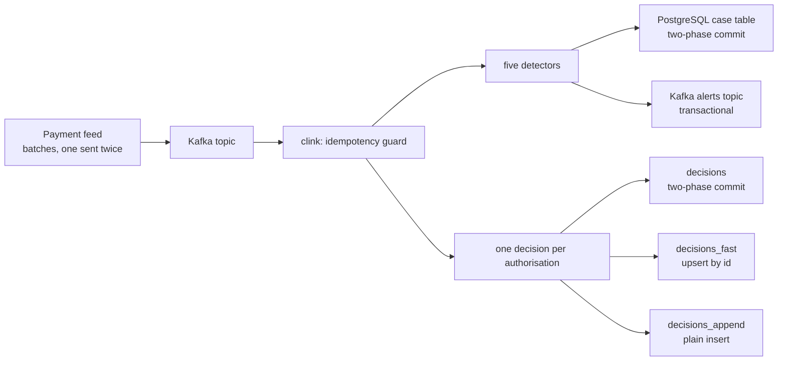

# card-sentry

Card-fraud detection and the response to it. Five pattern detectors and a
rules check watch card payments and account activity for fraud campaigns, every
card authorisation is decided, and each alert and decision is delivered to the
systems that act on it, exactly once, even when a Worker dies mid-stream and
the payment feed delivers a batch twice.

[Repository](https://github.com/orhaugh/card-sentry) · pinned to clink v0.15.0

## What it does

A generator writes a deterministic tape of card authorisations, logins,
one-time-password requests, password changes and transfers, out of event-time
order: three days of it, or ninety for the cluster scenes. Thirteen campaigns are planted on dedicated accounts: nine that must
raise an alert, and four negative controls that look close to fraud and must
not, such as a verified account recovery or a plausible journey between two
card-present payments.

| Check | The fraud it catches |
| --- | --- |
| Card testing | a burst of small declined payments, then one large approved one |
| Impossible travel | two card-present payments further apart than anyone could travel in the time |
| Account takeover | failed logins, a password change and a draining transfer, with no one-time password verified in between |
| Unverified one-time password | a code requested and never verified; the alert is the pattern that timed out |
| Structuring | transfers just under a reporting threshold whose running total crosses it |
| Watchlist and caps (rules) | payments at listed merchants or over a cap, with rules that arrive on a second stream and change without a redeploy |

The same detectors run three ways: embedded in one process over the tape, as
a compiled job on a Coordinator and two Workers, and as a payment rail that
reads Kafka and writes to PostgreSQL and Kafka:



## Where clink does the work

Kafka carries the feed, and PostgreSQL and Kafka hold the results. Detection,
decisions and the delivery guarantees are clink's.

| What happens | How clink does it | Read more |
| --- | --- | --- |
| Fraud is recognised as a sequence, an absence or a timeout | clink's C++ pattern API: quantifiers, negative zones inside a sequence, and timed-out partial matches as a side output | [Time, windows and CEP](../internals/time-and-windowing.md) |
| Late events still land in the right place | watermarks bounded at 60 seconds of event time | [Time, windows and CEP](../internals/time-and-windowing.md) |
| Rules change mid-stream | broadcast state, updated from a second stream | [State and backends](../internals/state-and-backends.md) |
| A batch sent twice counts once | the guard's seen-set is keyed state with an event-time expiry, checkpointed with everything else | [State and backends](../internals/state-and-backends.md) |
| A card's risk profile is looked up live | queryable state: JSON point lookups and scans over HTTP, straight from keyed state | [State and backends](../internals/state-and-backends.md) |
| The detectors run on a cluster | a compiled job plugin, built from the same pattern code as the embedded run | [Jobs as compiled plugins](../design/004-jobs-as-compiled-plugins.md) |
| Each alert lands once in PostgreSQL and in Kafka | a two-phase-commit sink (`PREPARE TRANSACTION` at the checkpoint barrier, `COMMIT PREPARED` once the checkpoint is durable) and Kafka transactions committed with the same checkpoint | [Sink committer framework](../internals/sink-committer-framework.md) |
| A killed Worker loses nothing and repeats nothing | the job rolls back to its last checkpoint, the Kafka source resumes from its checkpointed offsets, and recovery finishes the commits | [Checkpointing](../internals/checkpointing.md) |
| The profile changes shape between versions | a registered state migration, and a pre-deploy check that refuses the upgrade without it | [Fault tolerance and rescale](../internals/fault-tolerance-and-rescale.md) |
| A fired alert can be re-examined | the flight recorder and `clink replay --verify`, on the detectors' own C++ types | [Deterministic replay](../design/006-deterministic-replay.md) |

## What a run proves

An independent checker holds every run to the record of planted campaigns:
exactly the nine expected alerts, silence from all four controls, and no
alert anywhere else. Each detector also has its own tests through clink's
testing framework.

The payment-rail run kills a Worker with `SIGKILL` while alerts are
committing, after the producer has re-sent a batch. Read from outside clink,
the case table and the alerts topic (at `read_committed`) each end with
exactly the nine alerts. The three decision tables show what each delivery
guarantee buys in the run the README records: 569,873 authorisations give
569,873 rows in the two-phase-commit table, an upsert table identical to it,
and 7,600 duplicate rows in the plain-insert table, which is what at-least-once
means. The price is visibility: rows in the two-phase-commit table appear when
their checkpoint completes (about a second at the median with one-second
checkpoints), and the other two tables show them within tens of milliseconds.

Switching the guard off is the negative control: the re-sent batch reaches
the detectors twice and the checker fails the run. Exactly-once processing
guarantees each record affects the output once; it cannot know that two
records with one id are one event. That is domain logic, and the guard is
where it lives.

## What is distinctive here

The run is checked, not only its results. Every clink process can record the
protocol steps it takes, and the model checker follows a recorded rail run,
with its Worker kill and redeploy, through the TLA+ specification of clink's
exactly-once protocol. The run is accepted only if every step is one the
specification allows. The first recording found a case the model had not
covered, an interval in which a sink stages nothing; the specification was
extended for it, and that run is now one of the traces clink validates on
every push.

Every alert is also evidence: with the flight recorder on, an alert's epoch
replays offline byte for byte, and `--emit-test` freezes it into a regression
test.

## Run it

You need Python 3, CMake and a C++ compiler; the cluster and rail scenes also
need Docker.

```bash
git clone https://github.com/orhaugh/card-sentry && cd card-sentry
scripts/get-clink.sh            # the pinned clink release, into .clink/prefix
scripts/run-detections.sh       # tape, build, tests, detection and the checker
cluster/run-rail.sh             # Kafka in, PostgreSQL and Kafka out, a Worker killed
```

The repository's README covers the cluster run, the trace validation, replay
and the state upgrade.
