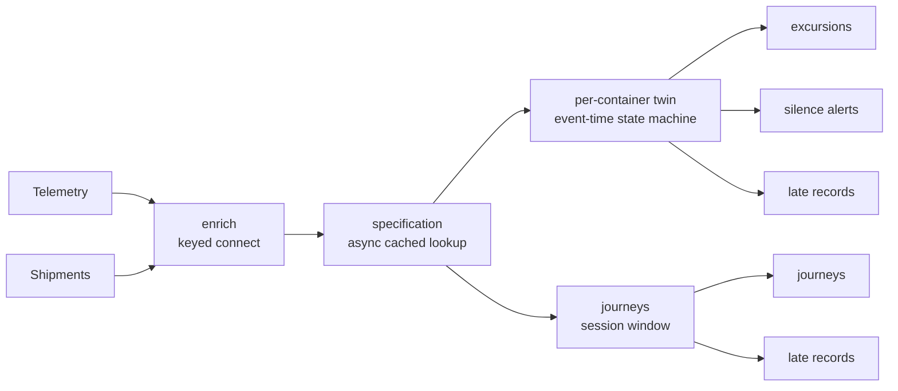

# coldchain

Monitoring for refrigerated freight. Containers report temperatures all the
time, and almost none of it matters. What matters is the shipment that spent
forty minutes above its limit, the container that went dark between Rotterdam
and Milan, and the door left open on a loading bay. Deciding which of those
happened is not a query over a table: it is a state machine per container,
running in event time, with clocks that have to survive a restart.

coldchain builds that on clink's typed C++ API, with no SQL. The whole graph is
one function, and both a single binary and a cluster job build from it.

[Repository](https://github.com/orhaugh/coldchain) · pinned to clink v0.15.0

## What it does

A generator writes three days of telemetry for forty containers, about 24,000
records out of event-time order, and the shipment assignments that say what each
container carries. Twenty-one incidents are planted: eleven that must raise an
alert (among them a failing cooling unit, a power loss, an open door and a
container that goes silent) and ten negative controls that must not, such as a door opened
briefly during loading or a single-sample sensor spike.



An excursion is defined by persistence: out of band, continuously, for longer
than the cargo tolerates, where the tolerance depends on what is loaded. A
silence alert is defined by the absence of data, so nothing arrives to trigger
it. Temperatures are integer milli-degrees, so no figure depends on the order a
fold happened to run in.

## Where clink does the work

coldchain is clink operators from end to end; the only other moving part is an
optional specification service.

| What happens | How clink does it | Read more |
| --- | --- | --- |
| Telemetry meets the shipment in force | a keyed two-input connect that holds a container's early records until its assignment arrives | [Operator model](../internals/operator-model.md) |
| Each cargo's tolerance comes from a service without stalling the stream | an asynchronous keyed operator with a per-container cache kept in the state backend | [Async state execution](../internals/async-state-execution.md) |
| Each container runs its own state machine | a keyed process function with event-time timers; the silence watchdog is a timer that fires when nothing arrives | [Time and windowing](../internals/time-and-windowing.md) |
| Records arrive out of order | each container's records are reordered by event time, and a record too late to order goes to a side output instead of being processed | [Time and windowing](../internals/time-and-windowing.md) |
| Journeys are summarised | a session window with an aggregate, allowed lateness and its own late output | [Time and windowing](../internals/time-and-windowing.md) |
| The fleet register exists before the first record | a savepoint written offline, before the job has ever run | [Fault tolerance and rescale](../internals/fault-tolerance-and-rescale.md) |
| One graph runs in a process and on a cluster | the same `define_pipeline` function builds the local binary and the job a cluster deploys | [Embedded-first](../design/002-embedded-first.md) |
| Operators are tested in isolation | clink's public test harness, with watermarks and timers driven by hand | [Testing framework](../internals/testing-framework.md) |

## What a run proves

The checker never reads coldchain's code or its state. It applies the written
alert rules to the raw tape from scratch and compares sets of alerts. The gate
expects exactly 10 excursions, 2 silence alerts, 10 records refused by the
detector as too late, 6 too late for the journey window, and 196 journeys, each
with the cause and severity the tape implies.

Three scenes then change how the pipeline runs and require the same answers:

- On a cluster: the same graph submitted to a Coordinator with two Workers is
  held to the same figures.
- With the specification service on the data path: the alerts must be identical,
  and the service is asked 170 times for 24,021 samples; the cache answers the
  rest.
- With a seeded fleet: two containers are left out of the savepoint written
  before the run, and exactly those two are reported as unregistered, with every
  other alert unchanged.

The operator tests pin the edges: a breach that recovers on exactly the sample
its dwell lands on reports nothing, five readings delivered backwards produce
the identical alert, and an open breach survives a snapshot and restore with its
original start time.

## What is distinctive here

One definition, two deployments, the same answers. The pipeline is a single C++
function: a single binary runs it in-process, a cluster runs it as a job, and
neither knows which is happening. Because every rule is in event time and every
figure is an integer, the checker holds both to the same exact set of alerts, so
what is verified on a laptop is what gets deployed.

The typed API is the other half. Rules defined by persistence and by absence are
state machines with timers, which is what this API is for and what SQL would make
contrived.

## Run it

You need Python 3, CMake and a C++ compiler. On Linux x86_64 the pinned clink
release installs as a prebuilt download; elsewhere it builds from source.

```bash
git clone https://github.com/orhaugh/coldchain && cd coldchain
scripts/get-clink.sh            # the pinned clink release, into .clink/
scripts/run-gate.sh             # tape, pipeline, checker and operator tests
scripts/scene-cluster.sh        # the same graph on a Coordinator and two Workers
```
