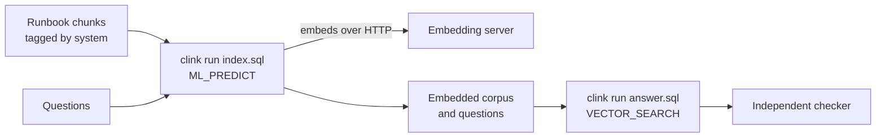

# grounded

Retrieval for an operations team's assistant. A corpus of runbooks is split
into chunks, embedded and held as a live vector index; a stream of questions is
embedded, matched against that index, and answered only from the chunks it
retrieves. The whole pipeline is two SQL files that clink runs in one process.

[Repository](https://github.com/orhaugh/grounded) · pinned to clink v0.15.0

## What it does

A generator writes fifteen runbooks across six systems (authentication,
database, network, payments, Kubernetes and backup), each tagged with its
system and severity and split into paragraphs. It also writes a labelled set
of questions and the chunk each one should retrieve.

The embedding model is deliberately simple and fully specified, so the
independent checker can compute exactly what clink should find: a hashed
bag-of-words vector of 512 dimensions, served over HTTP by a small Python
server. That server stands where a real embedding API would; pointed at one,
the same SQL runs unchanged, though that mode is not checked.



## Where clink does the work

The embedding model lives outside clink, behind HTTP. Calling it, holding the
index, retrieving and recording what was retrieved are clink's.

| What happens | How clink does it | Read more |
| --- | --- | --- |
| Chunks and questions become vectors | `CREATE MODEL embedder ... WITH ('provider' = 'http', ...)` and `ML_PREDICT` in SQL | [SQL reference](../sql.md) |
| Each question finds its nearest chunks | `VECTOR_SEARCH` over the embedded corpus | [SQL reference](../sql.md) |
| A question scoped to one system stays in it | the system tag passed to `VECTOR_SEARCH` as a pre-filter | [SQL reference](../sql.md) |
| A new runbook is retrievable without a restart | `corpus_refresh_ms` rebuilds the index inline on a running job | [SQL reference](../sql.md) |
| Each stage runs with no cluster | `clink run` executes the whole engine in one process | [Embedded execution](../internals/embedded.md) |
| A retrieval can be reproduced later | the flight recorder captures the `VECTOR_SEARCH` operator's input; `clink replay --verify` re-runs it | [Deterministic replay](../design/006-deterministic-replay.md) |

## What a run proves

The checker gates every question against the generator's record: each must
retrieve its intended chunk first, along with every other chunk ranked firmly
behind it. Six questions are scoped to one system, and three of those would
retrieve another system's runbook without the filter; for example, asking how
to fail over during an outage surfaces the DNS runbook unless the question is
scoped to payments. The checker also assembles an answer for each question and
fails the run if any answer cites a chunk that was not retrieved, so a
fabricated citation is caught.

A good run ends: 21 of 21 questions retrieve their intended chunk, 6 scoped
questions retrieve the right system, and 21 of 21 answers cite only retrieved
chunks.

## What is distinctive here

Retrieval you can prove afterwards. With the flight recorder on, the
`VECTOR_SEARCH` operator's captured epoch and the corpus reproduce the exact
retrieval offline, byte for byte, and `--emit-test` freezes it into a
regression bundle. "Which chunks grounded this answer, and can you prove it?"
gets an answer that can be re-run, not a log line.

The index is also live: a scene asks about a runbook that does not exist yet,
appends a hotfix runbook, and asks again; the second time the question
retrieves the hotfix, with no restart.

## Run it

You need Python 3.

```bash
git clone https://github.com/orhaugh/grounded && cd grounded
scripts/get-clink.sh            # once: the pinned clink release, into .clink/prefix
scripts/run.sh                  # generate, embed, index, retrieve, check
scripts/scene-live-corpus.sh    # a new runbook becomes retrievable
scripts/scene-replay.sh         # one retrieval replayed byte for byte
```
