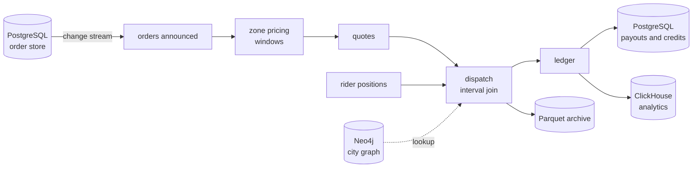

# half-time

A food-delivery platform on the night of a world final. Three cities order
through ninety minutes, extra time and penalties, and everyone orders at once at
half-time. Riders report where they are every twelve seconds, and stop
reporting when they stop to watch a goal. Everything the platform does with an
order happens in clink: it is announced, priced, quoted, given to the nearest
rider or escalated, and once delivered the rider is paid and a late customer
credited, exactly once.

It is deliberately convoluted, because real pipelines are: nineteen jobs,
eighteen in SQL and one in C++, over more systems than any other showcase, and
the outputs of one job are the inputs of the next.

[Repository](https://github.com/orhaugh/half-time) · needs clink 0.13.0 or
later

## What it does

The core of the night runs from the order store to the ledgers:



Every arrow between jobs is a Kafka topic. Around the core:

- the restaurants' menus live in MySQL and are read from its binary log;
- the kitchens' tablets talk over Pulsar, and a kitchen that bounces three
  orders in a row is reported to the floor over NATS;
- an order no rider was near goes to the operations desk's RabbitMQ queue and
  the partners' Pulsar topic;
- each order's latest state is kept in Redis and its history in Cassandra;
- the riders' phones report their batteries over MQTT, and a job in C++ keeps
  each rider's status in MongoDB and tells a rider whose battery runs low to
  charge;
- the broadcaster's feed is polled over HTTP, and each goal's surge of orders
  is counted;
- menu changes are indexed in OpenSearch, rider positions land in InfluxDB, the
  order stream is a Delta table, and each zone's price multiplier is a gauge in
  Prometheus and Grafana;
- after the night, a bounded job reads the Parquet archive back.

During the night a Worker is killed in the middle of the half-time surge, the
dispatcher is scaled to twice its parallelism for a goal while it runs, one job
is stopped at a savepoint and resumed from it, and the leading Coordinator is
killed so a standby takes over.

## Where clink does the work

The third-party systems store, carry and serve data. Every computation and
every delivery guarantee between them is clink's.

| What happens | How clink does it | Read more |
| --- | --- | --- |
| The order store is read once | PostgreSQL change data capture through a replication slot, announced on Kafka exactly once | [PostgreSQL connector](../connectors/postgres.md) |
| Each job reads only what the one before committed | every hop is a Kafka topic written in a transaction committed with the job's checkpoint | [Checkpointing](../internals/checkpointing.md) |
| Prices follow demand in event time | sliding windows over the last five minutes of each zone, every minute | [Time and windowing](../internals/time-and-windowing.md) |
| Each order gets the nearest rider | an interval join of orders with the positions of riders in their zone, and a Neo4j lookup of which zones touch the restaurant's | [Neo4j connector](../connectors/neo4j.md) |
| Payouts and credits land once, to the cent | two-phase commit into PostgreSQL | [Sink committer framework](../internals/sink-committer-framework.md) |
| A kitchen's bounces are spotted on a bus that repeats itself | events made distinct, then `MATCH_RECOGNIZE` in event time | [SQL reference](../sql.md) |
| Every output's guarantee is honest | the planner computes each job's guarantee from its sources and sinks, and refuses a declaration the path cannot honour, such as exactly once over a Pulsar source | [Delivery guarantees](../capabilities.md#delivery-guarantees) |
| The riders' phones are handled in C++ | a job module built against clink's installed package and submitted to the same Coordinator | [Jobs as compiled plugins](../design/004-jobs-as-compiled-plugins.md) |
| The dispatcher grows for a goal | the running join is rescaled at a checkpoint barrier, without stopping the job | [Hot rescale](../design/008-hot-rescale.md) |
| A Coordinator dies | the standby takes the leader lock and recovers all eighteen running jobs from their checkpoints | [Distributed runtime](../internals/distributed-runtime.md) |
| The night is checked against the protocol | every process records the exactly-once protocol's steps, and each job's run is validated against the specification | [Machine-checked exactly-once](../design/012-machine-checked-exactly-once.md) |

## What a run proves

The checks compare every store, row by row, with a reference model of the same
rules computed from the generated night alone, in event time, without clink.
Every order change is announced once; every pricing window has the model's
values; every order is decided once with the model's rider; every payout and
credit is there once, to the cent; every archive holds each record once. Stores
written at least once, such as the analytics tables, the Pulsar bus and the
Cassandra history, are checked for every row with the copies counted.

The protocol trace of a run, some 145,000 events, is checked job by job. In the
last full check, seventeen of the twenty jobs were accepted. Three are outside
what the specification models yet, and are skipped with their reasons: the
rescaled dispatcher, a job that commits through both Kafka and PostgreSQL, and
the job resumed from a savepoint, whose checkpoints are numbered on from its
savepoint's.

A run also measures what it costs. At thirty times real time on one machine,
the four clink processes, from a debug build, peaked at 1.0 GiB together, the two Workers at about a
fifth of a core each on average, while the fifteen systems they fed peaked at
8.2 GiB.

## What is distinctive here

Breadth with nothing taken on trust. Each of the night's outputs declares its
guarantee, and the planner refuses any declaration the path to it cannot honour,
so the SQL says plainly which stores are exactly once and which are at least
once. The checks then hold every store to that declaration, and the trace
validation checks the protocol steps behind it, job by job, across a Worker
kill, a live rescale, a savepoint and a Coordinator failover.

The night has also been a test of clink itself. Each defect its first runs
found, such as a keyed row's state filed under one key group while its rows
were routed by another, was reproduced in clink's own tests and fixed there
first.

## Run it

You need Docker with about 8 GB of memory for the seventeen containers, Python
3, clink 0.13.0 or later, and CMake and a C++23 compiler for the riders job.
Every system's own tools run inside its container, so nothing else is installed
on the host.

```bash
git clone https://github.com/orhaugh/half-time && cd half-time
CLINK_BIN_DIR=/path/to/clink/build ./run.sh
```

The repository's README covers the rules of the night, each job, the checks in
full, the flight recorder and the rig scripts.
