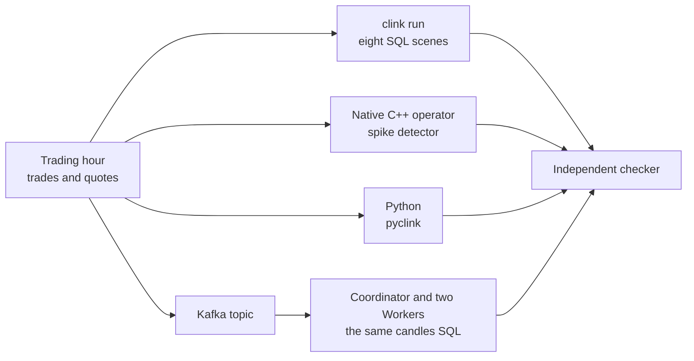

# market-pulse

A trading hour of market data, analysed the way a trading desk would want it:
one-minute price bars, volume leaders, spreads, a price reversal and a
mistyped print. Every analysis is a SQL file that clink runs in a single
process, with no cluster to stand up, and the same SQL also runs on a cluster
reading from Kafka.

[Repository](https://github.com/orhaugh/market-pulse) · pinned to clink
v0.15.0 · checked by its own CI on every push

## What it does

A generator writes a deterministic trading hour: about 114,000 trades and
229,000 quotes across 12 fictional symbols. Three incidents are planted at
known coordinates (a print at eight times the price, a five-minute V-shaped
reversal and a three-minute burst of trading), and 25 trades arrive 30 to 45
seconds after their minute has closed.



The scenes, each one SQL file:

| Scene | What it computes |
| --- | --- |
| Candles | one-minute price bars in event time; the late trades are dropped |
| Candles with lateness | the same bars, held open for a grace period that recovers exactly the 25 late trades |
| Volume leaders | the top three symbols by volume in each sliding window |
| Spread | each trade joined to the quotes from the 300 ms before it |
| Reversal pattern | the V-shape, found with `MATCH_RECOGNIZE` over the bars |
| Sessions | trading grouped into sessions; the burst fuses one symbol's into three-minute sessions |
| Cumulative volume | an expanding session-to-date volume board |
| Running statistics | running counts, a 100-row moving average and `LAG` |

Beside the scenes, a C++ operator catches the mistyped print, Python receives
the bars as a pyarrow table, the candles query runs on a cluster over Kafka,
and the same query turns a live exchange feed into bars over WebSocket.

## Where clink does the work

The tape is files and the answers are files, Kafka topics and Python tables.
Everything in between is clink.

| What happens | How clink does it | Read more |
| --- | --- | --- |
| A bar closes when its minute is over in event time, not when trades stop arriving | watermarks decide when a window is final; `allowed_lateness_ms` holds it open for stragglers | [Time and windowing](../internals/time-and-windowing.md) |
| The reversal is found as a pattern | `MATCH_RECOGNIZE` over the bars another scene wrote | [SQL reference](../sql.md) |
| Each trade meets the quotes before it | an interval join whose state the watermark evicts | [SQL reference](../sql.md) |
| The mistyped print raises one alert | a C++ operator keeps a per-symbol price average in keyed state, tested through clink's testing framework, including a snapshot and restore | [Testing framework](../internals/testing-framework.md) |
| A scene runs with no cluster | `clink run` executes the whole engine in one process | [Embedded execution](../internals/embedded.md) |
| Python gets the bars as a table | `pyclink` over `libclink`'s C interface and the Arrow C stream interface, with no serialisation step | [Embedded execution](../internals/embedded.md) |
| The same SQL runs on a cluster | a Coordinator and two Workers at parallelism 4; Kafka JSON decodes straight to Arrow columns, which move between Workers as columns | [Columnar execution](../internals/columnar-execution.md) |
| A stopped job's state is queried | checkpoints are documented Arrow IPC: `clink state-query` answers SQL over them, and `clink state-export` writes Parquet that DuckDB and pyarrow open | [State as open data](../design/003-state-as-open-data.md) |
| An incident replays | the flight recorder captures what each operator consumed; `clink replay --verify` re-runs it offline | [Deterministic replay](../design/006-deterministic-replay.md) |

## What a run proves

An independent checker recomputes what every scene should have produced from
the raw tape and the record of planted incidents, and pins the exact figures
for the default seed. CI runs the whole tour on every push: it installs the
pinned clink release, runs the scenes, builds and tests the operator, checks
that the detector raised exactly one alert (the planted print), and runs the
state and replay scenes. The cluster run passes only when exactly 720 bars
arrive on its output topic.

The live feed is a demonstration, not a check: an exchange's push stream has
no offsets to replay, so it is delivered at most once and stays out of CI.

## What is distinctive here

Two capabilities come from decisions at the root of clink's design. A job's
state outlives the job as data: once it has stopped, its last checkpoint
answers SQL and exports to Parquet, so analysts reach it with the tools they
already use. And an incident replays: the flight recorder keeps what each
operator consumed, `clink replay --verify` re-executes it offline and checks
that every emission is byte-identical, and `--emit-test` freezes that moment
into a regression bundle with the capture, the starting state, the expected
emissions and a generated test. For market data, where "why did the 09:17 bar
print that number?" can be a compliance question, an investigation ends as a
test that keeps the answer.

## Run it

You need Python 3; the C++ operator also needs CMake and a C++ compiler, and the
cluster scene needs Docker. On Linux x86_64 the pinned clink release installs as
a prebuilt SDK in about a minute; elsewhere it builds from source.

```bash
git clone https://github.com/orhaugh/market-pulse && cd market-pulse
scripts/get-clink.sh            # the pinned clink release, into .clink/
python3 tools/mpgen.py --out data
scripts/run-scenes.sh           # all eight scenes, then the checker
```

The repository's README covers the operator, Python, the cluster, the live
feed and the state and replay scenes.
