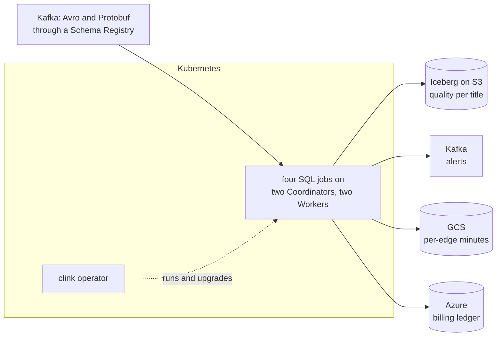

# playhead

A video service's playback analytics, run the way a platform team would run
it: on Kubernetes, by an operator, on a cluster that survives losing a Worker
or its leading Coordinator. Four SQL jobs read players' events and the CDN's
edge logs from Kafka and keep a quality-of-experience table in Iceberg, publish
alerts to Kafka, send the CDN vendor per-location minutes in Google Cloud
Storage, and write finance's billing ledger to Azure.

[Repository](https://github.com/orhaugh/playhead) · needs clink after 0.15.0
(a runtime image built from `main` until the next release)

## What it does

A generator writes half an hour of viewing: sessions that start, play, stall,
switch bitrate and stop, and fetch a segment from a CDN edge every few seconds.
Two incidents are planted: one title's new encode fails to start on most
devices, and one edge location answers slowly and sometimes with an error. A new
app version rolls out partway through, with a second Avro schema registered as
it ships.



The tape plays into Kafka at fifteen times real time, and three things go
wrong on purpose:

1. at minute 8, one job is upgraded to a new version of its script by changing
   its `ClinkJob` resource, while the tape plays on;
2. at minute 14, during the failing-title incident, a Worker is killed with
   `SIGKILL`;
3. at minute 20, the leading Coordinator's pod is killed.

Every third-party system runs beside the cluster in Docker: Redpanda for Kafka
and the Schema Registry, LocalStack for S3, an Iceberg REST catalog,
fake-gcs-server, Azurite, Marquez, and an OpenTelemetry Collector in front of
Jaeger and Prometheus.

## Where clink does the work

The clink operator turns two kinds of Kubernetes resource into a running,
secured cluster and its jobs. Everything between Kafka and the four stores is
clink.

| What happens | How clink does it | Read more |
| --- | --- | --- |
| The cluster is declared, not scripted | a `ClinkCluster`: two Coordinators electing a leader over a shared directory, two Workers, an API token on every request and mutual TLS between Workers and Coordinators, from Secrets | [Scale and operations](../capabilities.md#scale-and-operations) |
| Each job is a resource | one `ClinkJob` per SQL script, which the operator submits with the token | [Scale and operations](../capabilities.md#scale-and-operations) |
| Events are decoded by their schema | Avro, in two versions, and Protobuf, through the Schema Registry | [Schema Registry formats](../connectors/schema-registry.md) |
| Quality per title is kept in a table | event-time windows into Iceberg, one snapshot committed per checkpoint | [Iceberg connector](../connectors/iceberg.md) |
| Alerts are published once | a Kafka transaction per checkpoint, read at `read_committed` | [Kafka connector](../connectors/kafka.md) |
| The CDN vendor and finance get files | typed Parquet staged on GCS and Azure and published when its checkpoint commits; Azure's storage key comes from a Secret, never the SQL | [GCS Parquet](../connectors/gcs-parquet.md) |
| An upgrade loses and repeats nothing | the operator ends the job with a savepoint that cancels it, so no checkpoint commits after it, and submits the new script restored from it | [Fault tolerance and rescale](../internals/fault-tolerance-and-rescale.md) |
| A Coordinator dies | the standby takes the leadership and recovers every job | [Distributed runtime](../internals/distributed-runtime.md) |
| The run can be watched | spans and metrics over OTLP, and every job's lineage as OpenLineage events | [Data lineage](../internals/data-lineage.md) |

## What a run proves

The checker works out from the tape what every output must hold and reads each
one back: one row per title and minute in Iceberg with the counts the tape gives,
exactly the failing title-minutes on the alerts topic, one row per edge location
and minute on GCS, and one row per started session on Azure, none of them twice.
In the recorded run that is 396 title-minutes, 4 alerts, 198 edge-location
minutes and 6,000 billable sessions.

It then checks the platform: the API refuses a request without the token, the
leader accepts a Worker's certificate and refuses a client without one, every
`ClinkJob` is running, the upgraded job started from the savepoint its
predecessor ended at, the standby took the leadership, and the traces, metrics
and lineage reached Jaeger, Prometheus and Marquez. With the operator that is 21
checks, all passing; deployed from clink's Helm chart instead, the same run
passes the 16 that do not concern the operator.

## What is distinctive here

The platform way, at a small footprint. A sampler records what the run costs: the
four jobs carried 305,943 records through the upgrade, the Worker kill and the
failover, checkpointing every two seconds, on 11 CPU-seconds and under 800 MiB
between clink's five pods (two Coordinators, two Workers and the operator). The
whole run, cloud services included, peaks below 4 GiB.

The project also shaped clink. Its first upgrade and failover runs turned up
three defects: a checkpoint could complete between a savepoint and the cancel
that followed it, a Kafka record lost its partition on the network hop to its
decoder, and a restored job could let its fastest partition set the watermark.
Each was fixed in clink, with tests, before the results here were recorded.

## Run it

You need Docker with about 8 GB of memory, kind, kubectl, Python 3 and OpenSSL,
and a clink checkout beside the repository, from which the run builds the
operator. Until a clink release carries what playhead uses, run it against a
runtime image built from clink's `main`.

```bash
git clone https://github.com/orhaugh/playhead && cd playhead
CLINK_IMAGE=clink-runtime:<tag> CLINK_REF=<commit> ./run.sh
```

`DEPLOY=chart` runs the same cluster from clink's Helm chart instead, and needs
Helm. The
repository's README covers the variables, the tape and the checks in full.
