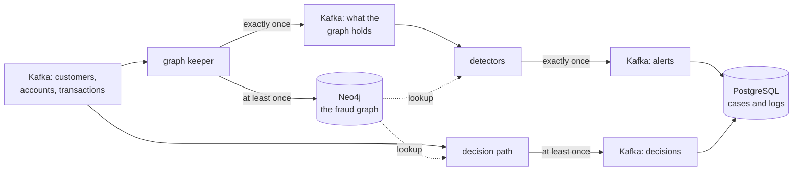

# transfer-sentry

Fraud detection on a graph of a bank's customers, accounts and transfers.
It takes Neo4j's public fraud-detection demo, which answers its questions over
a finished database, and runs it as a stream: every onboarding, account and
transfer is written into the graph as it happens, checked against the graph
around it, and every transfer is decided (approve, review or hold) while the
bank can still act on it.

[Repository](https://github.com/orhaugh/transfer-sentry) · needs clink 0.13.0
or later

## What it does

Seven SQL jobs share the work:

- The graph keeper writes customers, accounts and transactions into Neo4j,
  and announces on Kafka each event the graph now holds.
- The detectors read those announcements and ask the demo's own questions of
  each event: the transfer that closes a ring, the new customer who shares an
  identity with others, and the payment that ends a trail of money into a
  high-risk jurisdiction.
- The decision path decides every transfer as it arrives, from the payee's
  place in the graph: its owner, and whom that owner shares an email address,
  phone number or street address with, one and two steps away.
- The inbound screen watches payments into the bank's accounts for the
  marks of a money mule, and a profile job judges each transfer out against
  the payer's own history.
- Two more route alerts to a case store and log every decision in PostgreSQL.



## Where clink does the work

Neo4j holds the graph and answers the graph queries, and Kafka and PostgreSQL
hold the results. Keeping the graph current, deciding when it is safe to read,
the event-time profiles and every delivery guarantee are clink's.

| What happens | How clink does it | Read more |
| --- | --- | --- |
| The graph follows the bank's events | a SQL job writes through clink's Neo4j sink, with statements that converge when a batch is written again | [Neo4j connector](../connectors/neo4j.md) |
| Detectors never read ahead of the graph | the keeper writes the graph and its announcements in one job: the graph sink commits before it acknowledges a checkpoint, the announcements commit in a Kafka transaction only when the checkpoint completes, and one shared Kafka reader cuts both at the same barriers | [Checkpointing](../internals/checkpointing.md) |
| A transfer is decided from the graph | a lookup join from SQL into Neo4j, following shared identifiers two steps out | [Neo4j connector](../connectors/neo4j.md) |
| A transfer is judged against the payer's history | event-time `OVER` windows, one reading another | [SQL reference](../sql.md) |
| Each output gets the guarantee it declares | each sink is held to its own table's guarantee: the graph at least once; announcements, alerts and cases exactly once; decisions published at least once and logged exactly once | [Delivery guarantees](../capabilities.md#delivery-guarantees) |
| A killed Worker changes nothing | every job restores from its last completed checkpoint, and the Kafka sources resume from their checkpointed offsets | [Fault tolerance and rescale](../internals/fault-tolerance-and-rescale.md) |

## What a run proves

The checkers read every store through clients of their own and compare it
with what the demo's data says it must hold, computed without the pipeline.
The graph clink writes matches the demo's own export relationship for
relationship and property for property, so the demo's dashboard queries run
on it unchanged and give the demo's answers. In the last recorded run, every
one of the 58 alerts the data implies was raised once (4 rings, 50 shared
identities and 4 trails into high-risk jurisdictions), and all 300 transfers
were decided as the data implies and logged once.

That run killed a Worker with `SIGKILL` while transactions were flowing, with
171 of the 300 in the graph, then resent 20 transactions, 10 payments and 10
transfers out as a retrying producer would. No alert was raised twice, and no
log holds a decision twice.

Decisions are also timed. On one machine, with nothing failing, a transfer's
decision reached Kafka 28 ms after the transfer did at the median, the Neo4j
lookup included.

## What is distinctive here

Two jobs stay consistent without talking to each other. A lookup reads the
graph as it is when the read runs, and nothing in the read can prove another
job has already written the event it is about. So the detectors read the
keeper's announcements instead of the bank's streams, and an announcement
becomes visible only once the graph holds its event, and everything that
arrived before it. That guarantee is built from clink's checkpoint rules, not
from coordination between the jobs. The cost is latency: an event is checked
about one checkpoint interval after it arrives, which is why the decision path,
which cannot wait, reads the bank's transactions directly.

The project also shaped clink. Four capabilities were added for it: a delivery
guarantee per sink rather than per job, one shared Kafka reader per table, an
`OVER` window that reads another, and a common table expression that can be
read twice.

## Run it

You need Docker, Python 3 and a clink build of 0.13.0 or later. clink runs on
the host as a Coordinator and two Workers; Kafka, Neo4j and PostgreSQL run in
Docker.

```bash
git clone https://github.com/orhaugh/transfer-sentry && cd transfer-sentry
CLINK_BIN_DIR=/path/to/clink/build ./run.sh
```

`run.sh` fetches the demo at a pinned commit, generates the event streams,
submits the seven jobs, kills a Worker partway through, resends a batch, and
checks every store and every decision.
