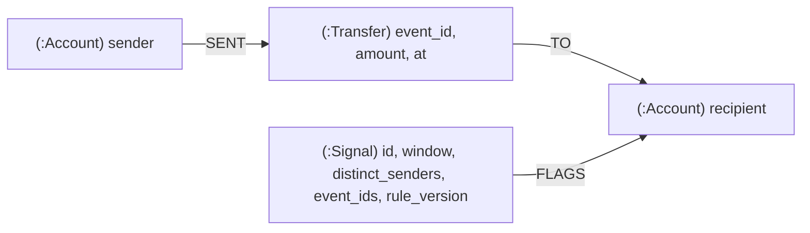

# Kafka -> clink -> Neo4j: transfers as a graph, with a fan-in indicator

A self-contained example on Docker Compose. Synthetic transfers between made-up
accounts stream from Kafka through clink into Neo4j as a graph, and clink
computes one explainable time-window indicator beside them: an account that,
inside one minute, receives money from at least five distinct senders. A
Worker is killed mid-run and restarted; the graph is then checked, node by
node and relationship by relationship, against what the input implies.

Everything here is synthetic. No account, amount or pattern belongs to anyone,
and a signal is an indicator for a person to review under one stated rule, not
a finding of wrongdoing. The example takes no action on a signal.

## Run it

Needs Docker with Compose, Python 3 and curl. One command:

```bash
cd examples/kafka-to-neo4j
CLINK_IMAGE=<a clink runtime image with the Neo4j sink> ./run.sh
```

The Neo4j sink is newer than the published `ghcr.io/orhaugh/clink-runtime:latest`,
so `CLINK_IMAGE` must name an image built after it was added. With a local build
instead, run the Coordinator and Worker on this machine and only Kafka and
Neo4j in Docker:

```bash
cmake --build ../../build --target clink_node clink --parallel 10
CLINK_BIN_DIR=../../build ./run.sh
```

`run.sh` starts Kafka and Neo4j, applies [`schema.cypher`](schema.cypher),
starts a Coordinator and a Worker, submits [`pipeline.sql`](pipeline.sql), sends
the first half of the transfers, SIGKILLs the Worker once some transfers are in
the graph and a checkpoint has completed, starts it again, sends the rest, and
runs [`scripts/verify.py`](scripts/verify.py). It ends with:

```
verify: OK. 331 transfers, 40 accounts and 3 signals, each exactly once, every relationship and property as the events imply
```

`CLEANUP=1 ./run.sh` removes everything at the end; otherwise `docker compose down -v`
does. Neo4j Browser is at http://localhost:7474 (user `neo4j`, password
`clink-example-pw`) while the stack runs. Host ports can be moved with
`NEO4J_HTTP_PORT`, `KAFKA_HOST_PORT` and `CLINK_HTTP_PORT`.

## What is in the graph



- `Account {id}`, `Transfer {event_id, amount, at, at_time}` and
  `Signal {id, account, window_start, window_end, distinct_senders, transfers,
  event_ids, rule_version, kind}`, each under a uniqueness constraint on its id.
- A signal keeps everything that explains it: its window, its counts, the event
  ids of the transfers in the window, sorted, and the rule version. Its id is
  `<account>:<window start ms>:<rule version>`, a function of those, so writing
  it twice writes the same node.

The workload ([`scripts/workload.py`](scripts/workload.py)) is deterministic:
background transfers between 37 accounts every two seconds of event time for
ten minutes, and three planted accounts (`acct-07`, `acct-19`, `acct-33`) that
each receive from six to eight distinct senders inside one minute and then send
money on shortly after. The signal sees only the first half of that; the
investigation queries follow the money.

## Investigating

[`queries.cypher`](queries.cypher) has the queries, runnable with
`./scripts/cypher.py "<query>"` or in Neo4j Browser:

1. the signals, newest first, with what raised them;
2. one signal explained from its supporting events, by event id;
3. what the flagged account sent within five minutes after its window closed;
4. two hops on, where that money went next;
5. accounts that paid into more than one flagged account;
6. a health check: every transfer has exactly one sender and one recipient.

## Why a replay changes nothing

The Neo4j sink delivers at least once. After the kill, the restored jobs resume
from their last completed checkpoint and write again the batches since then,
some of which the graph already holds. The statements make that harmless:

- accounts, transfers and signals are found by their ids with `MERGE`, under
  the uniqueness constraints, so a second write, or two at once, finds the node;
- a transfer's `SENT` and `TO`, and a signal's `FLAGS`, are created only by the
  transaction that creates the node (`ON CREATE SET n._created = true`, then a
  conditional `CALL`), so a replayed event creates no second relationship;
- a signal's event ids are stored sorted, so a replay that collects them in
  another order writes the same list.

A statement that `CREATE`d the transfers instead would write every replayed
one twice; the connector page's [Replay-safe statements](../../docs/connectors/neo4j.md#replay-safe-statements)
section has the rules, including the one for properties that newer events
overwrite.

## What is consistent with what

The two `INSERT`s are two jobs with two sinks, and every batch is its own Neo4j
transaction. So:

- a batch's transfers become visible together, but transfers from different
  batches, and the graph and the signals, do not become visible together;
- a signal can appear before the transfers that support it are written, or
  after: query 2 returns all of a signal's transfers only once the graph job
  has caught up, which is why it joins by event id rather than relying on a
  relationship the signal job would have had to wait for;
- each job's checkpoints are its own: after the kill, one job can replay more
  than the other.

`verify.py` waits until both jobs have caught up before it decides.

## Files

| File | What it is |
| --- | --- |
| `docker-compose.yml` | Kafka, Neo4j (the pinned build the connector's live suite tests), a Coordinator, a Worker, the submit step |
| `pipeline.sql` | the two jobs: transfers into the graph, and the windowed fan-in indicator |
| `schema.cypher` | the uniqueness constraints the statements rely on |
| `queries.cypher` | investigation queries |
| `scripts/workload.py` | the deterministic workload, and the recompute of the signals it implies |
| `scripts/produce_events.py` | sends the workload to Kafka |
| `scripts/verify.py` | checks the graph against the workload |
| `scripts/cypher.py` | a minimal Query API client, standard library only |
| `run.sh` | the whole run, kill included |
